# 🧟 Game Design Document (GDD) — Proyecto Supervivencia 3D
**Nombre Clave:** *Project: Bio-Tension 3D*  
**Versión:** 1.5 (Dualidad Micro-Macro RTS/3ª Persona, Paridad Universal de Ítems & q-Flow, Sustrato Dinámico, Z-Levels y Rendijas Tácticas)  
**Motor:** Godot Engine 4.x (3D / MIT License)  
**Perspectiva:** Dual Seamless: 3ª Persona Over-the-Shoulder ⟷ Isométrica Táctica ⟷ Macro RTS de Asentamiento (SpringArm continuo 360°)  
**Plataformas:** PC (Soporte nativo Gamepad Twin-Stick + Teclado y Mouse)  
**Pipeline:** Desarrollo asistido por Agentes de IA, Blender, Rig MakeHuman y Animaciones Mixamo  

---

## 1. 🎯 Visión y Pilares Fundamentales

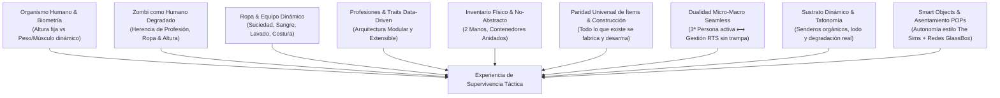

1. **El Organismo Biológico Completo:** El personaje no posee una "barra de vida genérica". Es un cuerpo humano vivo con órganos, volumen de sangre real ($5.0\text{ L}$), balance hídrico ($2.5\text{ L/día}$), temperatura corporal central ($37.0\text{ °C}$), masa muscular y grasa corporal dinámicas, y una psiquis interactiva.
2. **Biometría Inmutable vs. Evolutiva:** La **altura** y la genética ósea son inmutables tras la creación; en cambio, la **masa muscular**, la **grasa corporal** y la condición física evolucionan día a día según la ingesta calórica, las proteínas y el entrenamiento.
3. **El Zombi como Extensión Patológica:** El zombi deriva del modelo humano: conserva su altura original, su contextura física al morir y la ropa/equipo de su profesión previa (policías con chaleco, bomberos con hacha, médicos con bisturí).
4. **Sistema de Ropa y Mantenimiento:** La ropa se ensucia con barro, se empapa con sangre y sudor, pierde aislamiento térmico al mojarse y desprenden olores que atraen zombis. Todo elemento puede lavarse, desinfectarse, secarse y remendarse.
5. **Arquitectura Data-Driven Extensible:** Profesiones, traits, armas y ropa están desacoplados en `Custom Resources` independientes en Godot 4.x, permitiendo crear cientos de variantes mediante IA o modding sin tocar el código base.
6. **Paridad Universal de Ítems y Construcción:** *Todo lo que existe en el mundo físico puede ser fabricado y deconstruido por el jugador.* No existen objetos "estáticos decorativos intocables". Cada pared, puerta, mueble o herramienta posee una Bill of Materials (BOM) con masa sumatoria, dureza física y flujo de calidad ($q$-Flow).
7. **Dualidad Micro-Macro Seamless (3ª Persona ⟷ RTS):** El jugador puede encarnar físicamente a un superviviente en tercera persona sintiendo el esfuerzo y la tensión, o alejar la cámara suavemente al cielo para comandar la colonia en modo RTS. La simulación biológica y física no cambia jamás entre perspectivas.
8. **Sustrato Dinámico y Tafonomía Cadavérica:** El suelo no es una textura muerta; posee humedad, compactación mecánica que crea senderos de deseo (*desire paths*), y lodo reactivo. Los cadáveres sufren fases reales de descomposición con vectores de hedor y fertilización de nutrientes a largo plazo.
9. **Autonomía Comunitaria por Smart Objects & Redes POPs:** Los colonos operan mediante la arquitectura de objetos inteligentes de *The Sims* (la inteligencia y las acciones residen en los muebles e instalaciones, no en los scripts de los NPCs). Los asentamientos gestionan redes físicas discretas de agua y electricidad estilo *SimCity GlassBox* sin microgestión tediosa.

---

## 2. 🎮 Sistema de Controles y Cámara

### 2.1 Esquema de Entrada (Dual Support)

| Acción | Mando / Joystick (Twin-Stick) | Teclado & Mouse |
| :--- | :--- | :--- |
| **Mover Personaje** | Stick Izquierdo (Relativo a cámara) | `W`, `A`, `S`, `D` |
| **Apuntar / Mirada** | Stick Derecho (360°) | Cursor del Mouse |
| **Modo Combate / Táctico** | Gatillo Izquierdo (`LT` / `L2`) | Clic Derecho (Mantener) |
| **Atacar / Disparar / Empujar** | Gatillo Derecho (`RT` / `R2`) | Clic Izquierdo |
| **Rotar Cámara (360°)** | Botones `LB` / `RB` | `Q` / `E` o Botón Central del Mouse |
| **Interacción Rápida** | Botón `X` / `Cuadrado` | Tecla `E` / `F` |
| **Sprint / Sigilo** | `L3` (Click Stick) / `A` (`Cruz`) | `Shift` (Correr) / `Ctrl` (Agacharse) |
| **Inspección de Salud & Ropa** | `D-Pad Arriba` | Tecla `H` (Panel Paperdoll) |

### 2.2 Matemática de Movimiento Relativa a la Cámara
El vector de movimiento se proyecta siempre sobre la base orbital de la cámara activa:
$$\vec{V}_{\text{mov}} = (\text{Cam}_{\text{Right}} \cdot \text{Input}_x) + (\text{Cam}_{\text{Forward}} \cdot \text{Input}_y)$$

---

## 3. 👤 Creación de Personaje, Biometría y Sistema Extensible de Traits

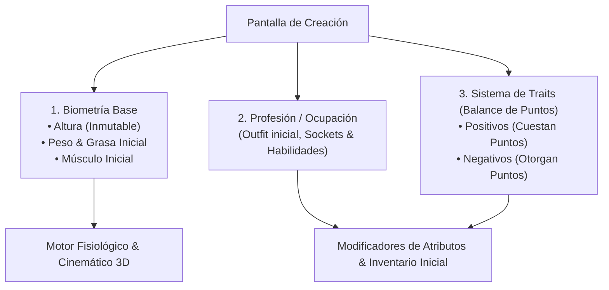

### 3.1 Biometría: Parámetros Inmutables vs. Dinámicos

* **Parámetros Inmutables (Definidos al inicio, no cambian jamás):**
  * **Altura ($1.50\text{--}2.05\text{ m}$):**
    * *Altura Alta ($>1.85\text{ m}$):* $+20\%$ alcance de golpe cuerpo a cuerpo, zancada más rápida, $+15\%$ tasa metabólica basal (mayor consumo calórico/agua), mayor área de impacto para ataques.
    * *Altura Baja ($<1.65\text{ m}$):* Menor radio de ruido de pisadas (sigilo $+30\%$), cobertura completa agachado detrás de muebles bajos, $-15\%$ gasto calórico diario, menor alcance de golpe.
  * **Grupo Sanguíneo ($O^-, O^+, A^-, A^+, B^-, B^+, AB^-, AB^+$):** Determina la compatibilidad para transfusiones de sangre con bolsas recolectadas.
  * **Estructura Ósea Base:** Longitud de miembros y resistencia base a fisuras.
* **Parámetros Dinámicos (Evolucionan en tiempo real durante la partida):**
  * **Masa Muscular:** Aumenta con superávit calórico + proteínas ($>80\text{ g/día}$) + esfuerzo físico; disminuye por desnutrición/sedentarismo (atrofia).
  * **Grasa Corporal:** Reserva energética de lípidos; se acumula por exceso calórico y se quema en inanición.
  * **Nivel de Hidratación:** Depósito de $2.5\text{ L}$ diario; se vacía por sudoración y respiración.
  * **Cicatrices y Callosidades:** Huellas visuales permanentes de heridas previas superadas.

---

### 3.2 Arquitectura Extensible de Profesiones (`ProfessionResource`)

Todas las profesiones son recursos desacoplados (`.tres` o `JSON`). Cualquier agente de IA o desarrollador puede añadir 50 profesiones nuevas creando un archivo de datos sin modificar código.

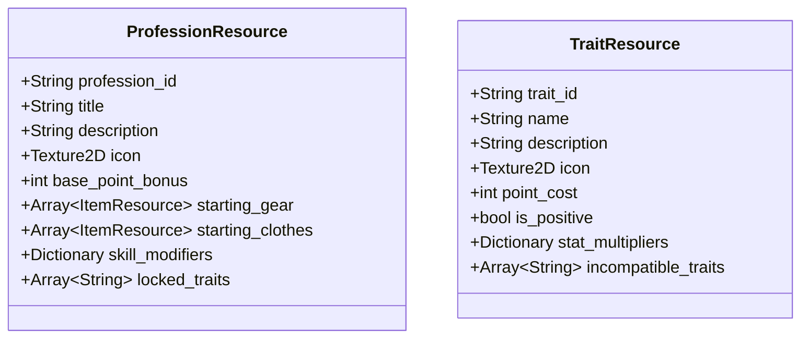

#### Ejemplos de Profesiones Base:

| Profesión | Bonificación de Puntos | Ropa & Equipo Inicial | Habilidades Únicas / Modificadores |
| :--- | :---: | :--- | :--- |
| 🩺 **Cirujano / Médico** | $-4\text{ pts}$ | Uniforme médico, botiquín de primeros auxilios, bisturí estéril. | Suturas y cirugías $2\times$ más rápidas; diagnóstico exacto de infección zombi; menor asco ante la sangre. |
| 👮 **Oficial de Policía** | $-6\text{ pts}$ | Uniforme policial, funda de muslo, pistola 9mm (1 cargador), porra. | Reducción de pánico al disparar ($50\%$); precisión de tiro incrementada; recarga táctica rápida. |
| 🚒 **Bombero** | $-5\text{ pts}$ | Chaqueta ignífuga (Capa 3), botas pesadas, hacha de bombero. | Fuerza muscular inicial $+20\%$; resistencia a la inhalación de humo; derriba puertas de madera en la mitad de tiempo. |
| 🏃 **Atleta / Entrenador** | $-6\text{ pts}$ | Ropa deportiva térmica, calzado de running, botella de agua de 1L. | Frecuencia cardíaca en reposo reducida ($50\text{ BPM}$); estamina $+50\%$; recuperación aeróbica ultra rápida. |
| 🔧 **Mecánico Automotriz** | $-3\text{ pts}$ | Mameluco de trabajo, guantes de cuero reforzados, llave inglesa. | Puede reparar motores, generadores y herramientas con la mitad de piezas de repuesto. |
| 📦 **Desempleado / Civil** | $+8\text{ pts}$ | Ropa casual estándar. | Sin bonificaciones de inicio, pero dispone de **+8 puntos** libres para gastar en traits positivos. |

---

### 3.3 Sistema Extensible de Rasgos (Traits & Flaws)

El jugador balancea su personaje mediante un sistema de **Puntos de Creación** (los traits positivos cuestan puntos; los traits negativos otorgan puntos).

```
[ PUNTOS DISPONIBLES: 0 ]
• Rasgos Positivos Seleccionados: -4 pts (Oído Agudo) + -6 pts (Músculo Fuerte) = -10 pts
• Rasgos Negativos Seleccionados: +4 pts (Fumador) + +6 pts (Miope) = +10 pts
• TOTAL: 0 pts (Personaje Balanceado)
```

#### Catálogo Modular de Traits:

| Trait | Costo en Puntos | Categoría | Efectos en Gameplay |
| :--- | :---: | :--- | :--- |
| 👁️ **Ojo de Halcón** | $-4\text{ pts}$ | Percepción | Cono de visión ampliado de $100^\circ$ a $130^\circ$; detecta zombis en sombras más rápido. |
| 👂 **Oído Agudo** | $-4\text{ pts}$ | Percepción | Radio de detección acústica a través de paredes incrementado un $40\%$. |
| 🩸 **Coagulación Rápida** | $-5\text{ pts}$ | Fisiológico | Las laceraciones y cortes superficiales sangran a la mitad de velocidad base. |
| 🛡️ **Piel Gruesa** | $-6\text{ pts}$ | Fisiológico | Probabilidad de sufrir laceraciones reducida un $30\%$; menor riesgo de raspaduras por ramas. |
| 🚬 **Fumador Compulsivo** | $+4\text{ pts}$ | Psicológico (Negativo) | La falta de tabaco genera ansiedad y estrés continuo; fumar genera **humo y olor** detectable por zombis. |
| 👓 **Miope** | $+6\text{ pts}$ | Médico (Negativo) | Requiere gafas de vista (Capa 5). Si caen en combate o se rompen, desenfoque masivo a más de 5 metros. |
| 🫁 **Asmático** | $+5\text{ pts}$ | Respiratorio (Negativo) | El sprint agota el oxígeno el doble de rápido; requiere inhalador de salbutamol para calmar ataques. |
| 🍫 **Glotón / Alto Apetito** | $+4\text{ pts}$ | Metabólico (Negativo) | Tasa de consumo calórico basal $+30\%$; penalización de moral severa con hambre. |
| 🧼 **Germofóbico** | $+4\text{ pts}$ | Psicológico (Negativo) | Pánico y estrés severo al vestir ropa ensangrentada o con barro; necesidad compulsiva de lavarse. |

---

## 4. 🧬 Anatomía, Equipamiento y Capas (Paperdoll 3D)

### 4.1 Divisiones Corporales y Granularidad Anatómica (13 Partes Clínicas)

A diferencia de modelos simplificados o bloques monolíticos, el organismo está subdividido en **13 zonas anatómicas independientes**, cada una con peso arterial, sockets de equipamiento y consecuencias motrices directas:

```
                                [ ESQUELETO HUMANO 3D (13 ZONAS) ]
                                                │
         ┌──────────────────────────────────────┼──────────────────────────────────────┐
         ▼                                      ▼                                      ▼
[ CABEZA & CUELLO ]                    [ TRONCO & EJE CENTRAL ]                 [ EXTREMIDADES ]
• Cráneo (HEAD)                         • Tórax Superior (TORSO_UPPER)          • Brazo Izq/Der (ARM_L / ARM_R)
  Trauma cerebral / Inconsciencia         Caja torácica / Impacto cardíaco        Fuerza de golpe / Carga
• Cuello (NECK)                         • Abdomen (TORSO_LOWER)                 • Mano Izq/Der (HAND_L / HAND_R)
  Hemorragia arterial crítica x2.5        Evisceración / Digestión / Shock        Empuñar armas / Recarga táctica
                                        • Pelvis / Ingle (GROIN)                • Pierna Izq/Der (LEG_L / LEG_R)
                                          Arteria femoral x2.0 / Movilidad        Cojera / Velocidad locomotriz
                                                                                • Pie Izq/Der (FOOT_L / FOOT_R)
                                                                                  Microtrauma descalzo / Vidrio
```

| Zona Anatómica (`PartType`) | Peso Arterial | Sockets Asociados | Penalización por Trauma / Lesión |
| :--- | :---: | :--- | :--- |
| **`HEAD` (Cráneo / Cara)** | $1.8\times$ | Cascos, gorras, gafas, máscaras | Aturdimiento, visión borrosa, pérdida de conciencia. |
| **`NECK` (Cuello)** | $2.5\times$ | Bufandas, collares, protectores | Hemorragia arterial fulminante (muerte en $<20\text{ s}$ sin torniquete/vendaje). |
| **`TORSO_UPPER` (Tórax)** | $1.5\times$ | Chalecos balísticos, remeras, abrigos | Capacidad pulmonar reducida, estamina $-40\%$, taquicardia. |
| **`TORSO_LOWER` (Abdomen)** | $1.4\times$ | Fajas, cinturones tácticos | Dolor severo al doblarse, detención de digestión gástrica. |
| **`GROIN` (Pelvis / Ingle)** | $2.0\times$ | Ropa interior, pantalones reforzados | Riesgo de sección de arteria femoral; cojera severa. |
| **`LEFT_ARM` / `RIGHT_ARM`** | $1.0\times$ | Mangas, coderas | Reducción de daño cuerpo a cuerpo y velocidad de balanceo. |
| **`LEFT_HAND` / `RIGHT_HAND`** | $0.8\times$ | Guantes tácticos, vendajes, reloj | Caída de arma (*fumbling*), recarga $3\times$ más lenta, pérdida de puntería. |
| **`LEFT_LEG` / `RIGHT_LEG`** | $1.4\times$ | Pantalones, rodilleras, fundas musleras | Cojera activa, prohibición de sprint, tropiezo al correr. |
| **`LEFT_FOOT` / `RIGHT_FOOT`** | $0.9\times$ | Calzado deportivo, botas, medias | Laceraciones por pisar vidrios; microtrauma de impacto descalzo. |

### 4.2 Capas de Ropa (Anti-Clipping System)
* **Capa 0 (Piel / Base):** Malla humana desnuda base con deformación por Blendshapes (Músculo/Grasa).
* **Capa 1 (Ropa Interior):** Bóxers, tops, calzoncillos largos, ropa térmica.
* **Capa 2 (Prendas Base):** Remeras, camisas, pantalones livianos de tela.
* **Capa 3 (Prendas Exteriores / Armadura):** Chaquetas impermeables, abrigos pesados, chalecos antibalas.
* **Capa 4 (Equipo Táctico & Carga):** Mochilas, arneses de pecho, cinturones con fundas.
* **Capa 5 (Accesorios & Joyería):** Relojes de muñeca, gafas de vista, anillos, collares.

> [!TIP]
> **Optimización 3D:** Al equipar prendas cerradas (pantalones largos, botas altas o chaquetas abotonadas), el motor oculta automáticamente los sub-meshes de la Capa 0 subyacente para ahorrar ciclos de render y eliminar el solapamiento visual (*clipping*).

---

## 5. 🧼 Sistema de Ropa, Suciedad, Sangre, Contaminación y Mantenimiento

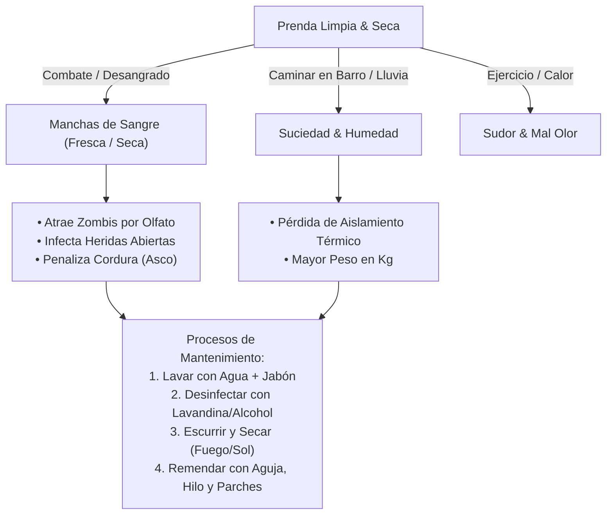

### 5.1 Estados Físicos de las Prendas

| Variable | Rango | Causas | Consecuencias en Gameplay |
| :--- | :---: | :--- | :--- |
| **Suciedad (Barro/Tierra)** | $0\text{--}100\%$ | Caídas, arrastrarse por el suelo, lluvia. | Aumenta probabilidad de infección en heridas si roza la piel; reduce moral. |
| **Sangre Humana / Animal** | $0\text{--}100\%$ | Sufrir laceraciones o manipular cadáveres frescos. | Emisión alta de olor detectable por zombis; disconfort mental. |
| **Sangre Infectada (Zombi)** | $0\text{--}100\%$ | Combate cuerpo a cuerpo a corta distancia, salpicaduras. | **Riesgo crítico:** Infección vírica inmediata si entra en contacto con heridas abiertas. |
| **Humedad (Agua/Sudor)** | $0\text{--}100\%$ | Lluvia, cruzar ríos, sudoración por hipertermia. | **Conductividad térmica x5:** La ropa mojada congela al jugador en frío. Aumenta el peso total en Kg. |
| **Integridad / Durabilidad** | $0\text{--}100\%$ | Mordeduras, cortes, disparos, desgaste de uso. | Con $<40\%$ de integridad, la prenda sufre agujeros (pierde protección física y térmica en esa zona). |
| **Esterilidad** | Booleano | Hervido, alcohol isopropílico, lavandina. | Esencial para vendas y apósitos médicos; reduce a $0\%$ la tasa de infección por apósito. |

### 5.2 Mecánicas de Limpieza y Mantenimiento

1. **Lavado de Prendas:**
   * **Agua Simple (Grifo, Río, Balde):** Remueve el barro ($100\%$) y la sangre fresca ($70\%$). Deja la prenda con $100\%$ de humedad.
   * **Agua + Jabón / Detergente:** Remueve toda suciedad ($100\%$), sangre seca y el $100\%$ del rastro de olor corporal y sudor acumulado.
2. **Desinfección Química:**
   * **Lavandina (Lejía) / Alcohol:** Neutraliza completamente la sangre infectada y patógenos zombi. Restaura el estado de esterilidad si se aplica a telas.
3. **Escurrido y Secado:**
   * **Escurrir a Mano:** Acción rápida de 3 segundos que reduce la humedad del $100\%$ al $45\%$.
   * **Secado al Fuego / Estufa / Radiador:** Seca la ropa en $5\text{--}10\text{ minutos}$ dentro del radio de calor.
   * **Secado al Aire Libre (Tenderete/Viento):** Depende de la humedad ambiental y la radiación solar ($30\text{--}60\text{ minutos}$).
4. **Costura y Remendado:**
   * **Herramientas:** Aguja de coser + Hilo / Hilo dental + Parches (Trozos de tela, cuero o cinta adhesiva táctica).
   * **Efecto:** Restaura la durabilidad y cierra los agujeros, recuperando la protección térmica y de mordeduras original de la prenda.

---

## 6. 🩻 Traumatología, Heridas y Amputación de Emergencia

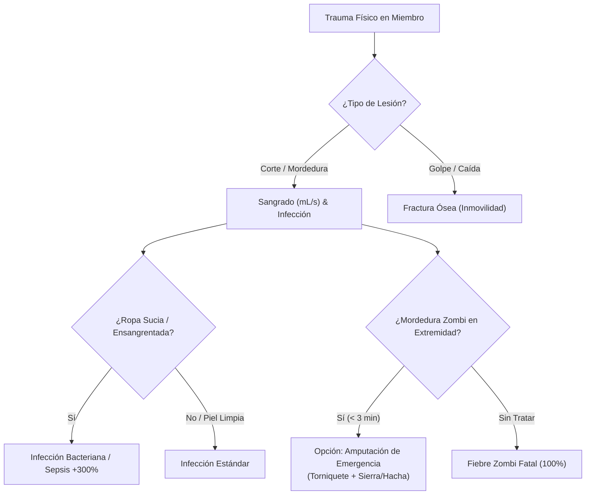

### 6.1 Catálogo de Traumatismos y Ciclo de Vida de Heridas (`WoundData`)

A diferencia del sistema de temporizadores flotantes simples de Project Zomboid (`scratchTime`, `cutTime`), cada traumatismo se gestiona como una estructura de datos `WoundData` alojada en la zona anatómica correspondiente:

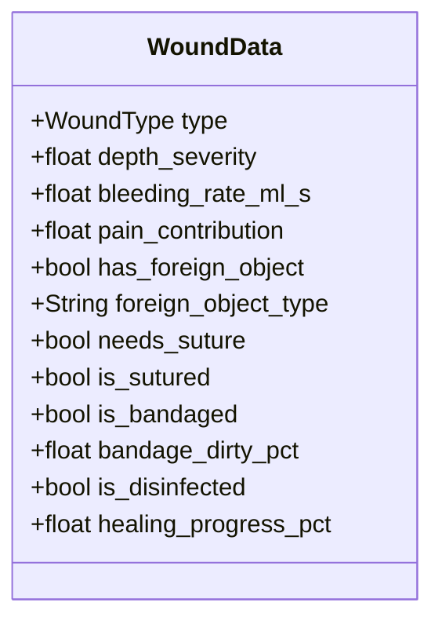

| Tipo de Herida | Causa Común | Tasa Sangrado | Cierre / Tratamiento Clínico Obligatorio | Consecuencia si se Ignora |
| :--- | :--- | :---: | :--- | :--- |
| **Corte Superficial (*Scratch*)** | Ramas, alambre de púas, tropiezo | $2\text{--}5\text{ mL/s}$ | Lavado con agua + Venda simple | Infección cutánea local ($+15\%$ dolor). |
| **Laceración Profunda (*Laceration*)** | Vidrio roto, zarpazo, cuchillo | $10\text{--}30\text{ mL/s}$ | Desinfección + **Sutura (Aguja/Hilo)** + Venda | Desangrado severo; no cicatriza en movimiento. |
| **Perforación / Bala (*Puncture*)** | Disparo, clavo oxidado, punzón | $20\text{--}60\text{ mL/s}$ | **Extracción con Pinzas** + Torniquete + Venda | Objeto alojado impide cicatrizar; tétanos/sepsis. |
| **Mordedura Zombi (*Bite*)** | Contacto directo con infectado | $15\text{--}40\text{ mL/s}$ | **Amputación inmediata ($<180\text{ s}$)** | Fiebre viral sistémica, colapso y zombificación. |
| **Fractura Ósea Cerrada** | Caída de altura, golpe contundente | $0\text{ mL/s}$ | **Férula rígida (*Splint*)** + Reposo prolongado | Imposibilidad de locomoción; dolor incapacitante. |
| **Quemadura Térmica** | Fuego directo, explosión, vapor | $0\text{ mL/s}$ | Ungüento antiséptico + Apósito estéril | Pérdida de barrera epidérmica; infección al $85\%$. |

### 6.2 Objetos Alojados y Procedimientos Quirúrgicos (Pinzas, Sutura y Vendajes)
1. **Extracción de Cuerpos Extraños (`has_foreign_object`):**
   * Balas o esquirlas de vidrio deben ser retiradas manualmente con **Pinzas Médicas (*Tweezers*)** antes de suturar o vendar.
   * Si se venda sin extraer el objeto, cada paso o movimiento de la extremidad clava el objeto más profundo, multiplicando el dolor en $+20$ y reabriendo el sangrado.
2. **Sutura Médica (`needs_suture`):**
   * Las heridas profundas tienen bordes separados. Sin sutura con **Aguja Quirúrgica o Hilo de Seda/Nylon**, la tasa de cicatrización se reduce en un $90\%$, y cualquier esfuerzo físico (correr, golpear) reabre la herida en un $100\%$.
3. **Ciclo de Degradación del Vendaje (`bandage_dirty_pct`):**
   * Un vendaje aplicado absorbe sangre y sudor. Cada 30 minutos de juego activo aumenta su suciedad.
   * Si `bandage_dirty_pct > 70%`, el vendaje pasa de proteger a ser un foco de proliferación bacteriana, aumentando la tasa de sepsis de la zona. Es imperativo retirar la venda, limpiar la herida con alcohol o agua oxigenada y colocar una venda limpia/estéril.

### 6.3 Mecánica de Amputación de Emergencia
* **Condición:** Mordedura confirmada en antebrazo (`HAND/ARM`) o pierna/pantorrilla (`FOOT/LEG`).
* **Ventana de Tiempo Fisiológica:** Menos de $180\text{ segundos}$ antes de que los viriones alcancen el torrente circulatorio central (vena cava/corazón).
* **Protocolo Quirúrgico en 3 Pasos:**
  1. **Torniquete Previo:** Bloquear el flujo arterial proximal al corte. Si no se aplica torniquete, la amputación produce una hemorragia de $120\text{ mL/s}$ provocando choque hipovolémico letal en $<40\text{ s}$.
  2. **Sección Ósea:** Cortar con sierra para huesos, serrucho o machete afilado (tiempo de ejecución: 4 a 8 segundos según fuerza y herramienta).
  3. **Hemostasia y Cauterización:** Sutura de muñón o cauterización al fuego + vendaje estéril masivo.
* **Secuelas Permanentes en Cinemática:**
  * **Amputación de Mano/Brazo:** Pérdida definitiva del uso de armas a dos manos (fusiles, escopetas, hachas pesadas); recarga de pistola con una sola mano significativamente más lenta.
  * **Amputación de Pie/Pierna:** Requiere muleta de apoyo o prótesis artesanal; incapacidad de sprint permanente, reducción de velocidad al $40\%$.

---

## 7. 🫀 Motor Fisiológico Completo del Ser Humano

### 7.1 Sistema Cardiovascular y Volemia
* **Volumen Total:** $5.000\text{ mL}$ ($5.0\text{ L}$).
* **Frecuencia Cardíaca (BPM):**
  * Reposo: $60\text{--}75\text{ BPM}$ (modificado por traits y fitness).
  * Sprint / Pánico / Combate: $140\text{--}180\text{ BPM}$.
* **Matemática de Sangrado por Frecuencia Cardíaca:**
  $$\text{Sangrado Real (mL/s)} = \text{Tasa Base} \times \left( \frac{\text{BPM}}{75} \right)^{1.5}$$
* **Umbrales de Pérdida de Sangre:**
  * Pérdida $> 1.0\text{ L}$ ($20\%$): Fatiga severa, palidez, pulso débil, manos temblorosas.
  * Pérdida $> 1.5\text{ L}$ ($30\%$): Shock hipovolémico, visión borrosa, desmayos intermitentes.
  * Pérdida $> 2.2\text{ L}$ ($44\%$): Paro cardíaco y muerte biológica.

### 7.2 Termorregulación y Balance Hídrico
* **Temperatura Central:** $37.0\text{ °C}$ base.
  * *Hipotermia ($<35.0\text{ °C}$):* Temblores severos (fallo de puntería), rigidez muscular, letargo.
  * *Hipertermia ($>39.0\text{ °C}$):* Sudoración masiva, mareos, colapso térmico.
* **Balance Hídrico:** Depósito funcional de $2.5\text{ L}$ diarios.
  * Deshidratación tras 24h (estamina $-50\%$), 48h (confusión y espasmos), 72h (falla renal fatal).

---

## 8. 👃 Sistema de Olor Corporal y Emisión de Rastros (Scent Layer)

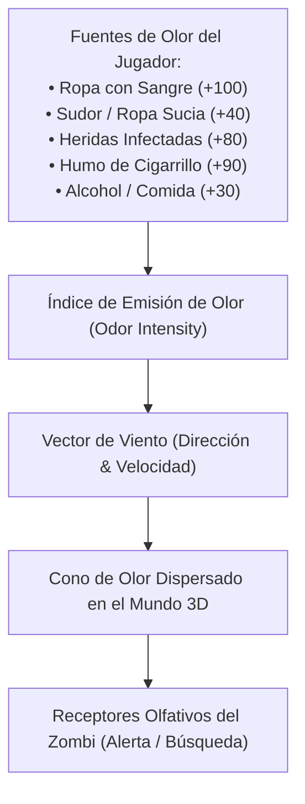

| Fuente de Olor | Intensidad Relativa | Persistencia | Método de Eliminación |
| :--- | :---: | :--- | :--- |
| **Sangre Fresca en Ropa/Piel** | $100\text{ pts}$ | Alta ($60\text{ pts}$ al secarse) | Lavar con agua o cambiarse de ropa |
| **Herida Abierta / Supuración** | $85\text{ pts}$ | Continua hasta cicatrización | Desinfectar y aplicar apósito estéril |
| **Sudor Intenso / Suciedad** | $45\text{ pts}$ | Media | Bañarse / Lavar ropa con jabón |
| **Humo de Cigarrillo** | $90\text{ pts}$ | Corta ($5\text{ min}$) | Evitar fumar cerca de hordas |
| **Comida caliente / Carne cruda** | $50\text{ pts}$ | Media | Guardar en recipientes herméticos |

---

## 9. 🏋️‍♂️ Fitness, Nutrición y Metabolismo Dinámico

$$\text{Masa Total} = \text{Masa Ósea} + \text{Masa Muscular} + \text{Grasa Corporal} + \text{Agua}$$

* **Entrenamiento y Adaptación Física:**
  1. *Fuerza / Hipertrofia (Flexiones, Cargar Peso, Talar):* Aumenta masa muscular y daño de golpe; requiere superávit calórico + proteínas ($>80\text{g/día}$) + sueño.
  2. *Cardiovascular / Resistencia (Trotar, Correr):* Reduce el pulso en reposo, aumenta la estamina y la recuperación aeróbica.

---

## 10. 🧠 Motor Psicológico (Psiquis & Salud Mental)

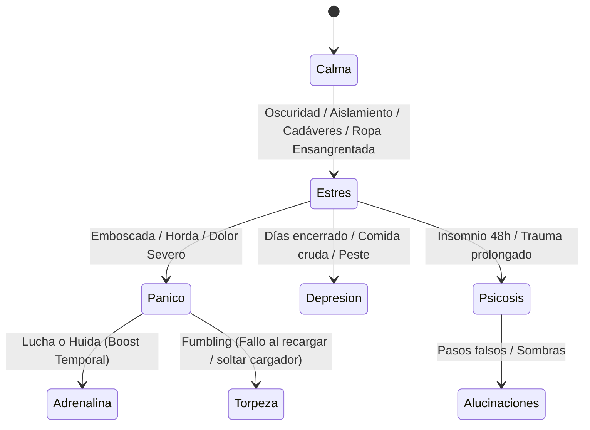

### 10.1 Dinámica Neuroquímica y Estados Mentales
* **Pánico vs. Estrés:**
  * **Estrés (Acumulativo Lento):** Producido por ropa ensangrentada, heridas sin vendar, oscuridad, malnutrición o cadáveres próximos. Reduce la recuperación pasiva de estamina hasta en un $40\%$.
  * **Pánico (Respuesta Aguda de Alarma):** Disparado por emboscadas zombi, heridas súbitas o ruidos estrepitosos. Desencadena la liberación de **Adrenalina**.
* **El Ciclo de Adrenalina (*Fight or Flight*):**
  * **Fase 1 (Pico de Adrenalina - 30 a 60 s):** Aumenta el ritmo cardíaco $+35\text{ BPM}$, reduce la percepción subjetiva de dolor en un $60\%$ (permite seguir corriendo con heridas leves) y otorga $+15\%$ de velocidad de zancada.
  * **Fase 2 (Bajón / Crash Adrenérgico):** Cuando el peligro cesa, la adrenalina cae súbitamente, revelando el dolor reprimido ($+100\%$ de golpe) y provocando un agotamiento agudo de estamina ($50\%$ durante varios minutos).

### 10.2 Torpeza Motriz (*Fumbling*), Temblores y Dispersión de Puntería
* **Matemática de Fumbling al Manipular Ítems o Recargar:**
  $$\text{Probabilidad Fumble} = \text{clamp}\left( \left(\frac{\text{Pánico} - 50}{50}\right)^2 \times 0.45 + \left(\frac{\text{Dolor Manos}}{100}\right) \times 0.35, \, 0.0, \, 0.80 \right)$$
  * Si se dispara *Fumble*, el personaje suelta el cargador o la venda al suelo (creando un ítem físico 3D que debe recogerse) y emite un gemido de frustración.
* **Dispersión de Armas por Manos Temblorosas:** Con pánico $>50\%$ o dolor en brazos/manos, el cono de dispersión balística se abre un $+120\%$, impidiendo disparos precisos a la cabeza.
* **Distorsión Sensorial:**
  * **Visión de Túnel (GPU Shader):** Viñeta radial oscura y desenfoque gausiano perimetral que reduce el campo de visión periférico.
  * **Oclusión Auditiva (Godot AudioBus):** Filtro pasa-bajos (*Low-Pass Filter*) que atenúa ruidos lejanos y resalta el sonido sordo y acelerado de los latidos cardíacos (`CardiovascularSystem.heart_rate_bpm`).

---

## 11. 🧟 Patología Zombi, Derivación y Generación Procedural

El zombi es un **cadáver humano reanimado patológicamente**, que hereda la altura, contextura y profesión previa del fallecido.

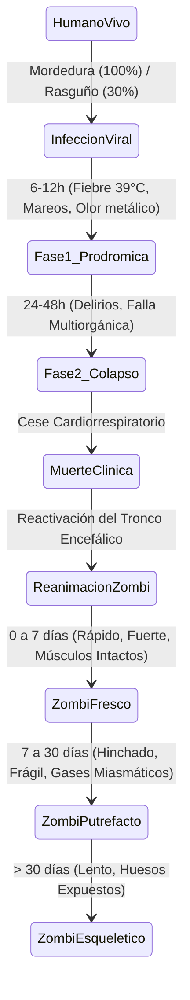

### 11.1 Zombis con Profesiones Previas (Variedad de Botín y Resistencia)
Los zombis en el mundo 3D se generan con la ropa y equipo de su vida anterior:
* 👮 **Zombi Policía / Militar:** Viste chaleco balístico (reduce daño de disparos al pecho un $70\%$) y puede portar una pistola o munición en su funda.
* 🚒 **Zombi Bombero:** Viste chaqueta ignífuga y casco reforzado; suele tener un hacha clavada o en su equipo.
* 🩺 **Zombi Médico / Enfermero:** Viste bata médica; suele llevar vendas estériles, alcohol o pastillas en sus bolsillos.
* 🏃 **Zombi Atleta:** Mayor velocidad de desplazamiento base gracias a su longitud de zancada y zapatillas de running intactas.

### 11.2 Daño Localizado y Desmembramiento del Zombi
* **Destrucción de Pierna / Rodilla:** El zombi cae y pasa a estado **Reptador (*Crawler*)**.
* **Destrucción de Brazos:** Incapaz de forcejear / agarrar al jugador.
* **Destrucción de Mandíbula:** Incapaz de morder (solo golpes torpes).
* **Destrucción Craneal:** Muerte / neutralización definitiva.

---

## 12. 📦 Inventario Físico y Arquitectura Data-Driven en Godot 4.x

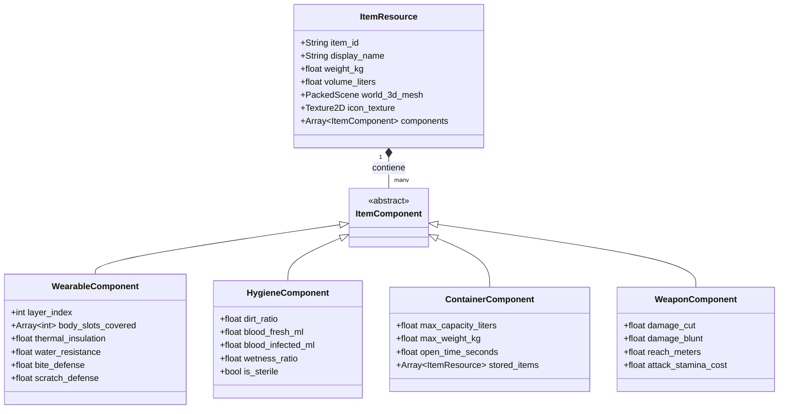

---

## 13. 🤖 Pipeline de Creación de Contenido Asistido por IA

| Área | Herramienta / Modelo | Salida / Integración en Godot 4 |
| :--- | :--- | :--- |
| **Modelos 3D & Anatomía** | Meshy.ai / Tripo3D / Rodin / MakeHuman | Archivos `.glb` con esqueleto humano modular y blendshapes de músculo/grasa |
| **Texturas & Mapas de Sangre** | Polycam / Stable Diffusion | Mapas Albedo, Normal, Roughness y máscaras RGBA de suciedad/sangre dinámica |
| **Animación & Física** | Mixamo + Cascadeur | Animaciones con física de balanceo, tropiezos y cojeras retargeteadas |
| **Audio & SFX** | ElevenLabs / Suno / AudioCraft | Jadeos de respiración, latidos cardíacos dinámicos, sonidos de rasgado de ropa |
| **Lógica & Datos JSON** | Claude 3.7 / Codex / o1 | Recursos GDScript (`.tres`) y tablas de datos para 100+ profesiones y traits |

---

## 14. 🗺️ Hoja de Ruta del Proyecto

```
┌─────────────────────────────────────────────────────────────────────────┐
│              HITO 1: EL SANDBOX BIOLÓGICO (HUMANO VS ZOMBI)             │
├─────────────────────────────────────────────────────────────────────────┤
│ 👤 1 Humano con biometría (Altura fija, Grasa/Músculo dinámicos)        │
│ 💼 Selector de Profesión inicial y Traits (Data-driven con .tres)       │
│ 👕 Sistema de Ropa con suciedad, sangre, lavado, desinfección y secado  │
│ 🩻 Traumatología activa: Laceraciones, fracturas y amputación en vivo    │
│ 🧟 1 Zombi derivado con IA sensorial (Oído con oclusión, Visión y Olor) │
│ ⚔️ Mecánica de forcejeo, desmembramiento zombi y destrucción craneal    │
│ 🎮 Control Twin-Stick + Teclado/Mouse con cámara rotatoria 360°        │
└─────────────────────────────────────────────────────────────────────────┘
```

---

## 15. 🎬 Catálogo Maestro de Animaciones & MoCap Requeridas

Para que la simulación biológica y médica tenga impacto jugable, el sistema visual (`HumanCharacter` y su `AnimationTree`) debe reflejar cada traumatismo, debilidad y procedimiento fisiológico mediante animaciones dedicadas.

### 15.1 Estado Actual en el Proyecto (`char_human/anim/`)
Actualmente contamos con el ciclo de locomoción y muerte básica retargeteado:
* ✅ `Idle` (Reposo normal)
* ✅ `Walking`, `Running`, `Sprint` (Locomoción escalada por cadencia)
* ✅ `Standing To Crouched` (`Crouch_Down`) / `Crouch To Stand` (`Crouch_Up`)
* ✅ `Fall Flat` (Colapso frontal / síncope)
* ✅ `Falling Forward Death` (`Death_Forward`) / `Standing React Death Forward` (`Death_Forward_React`)
* ✅ `Standing React Death Backward` (`Death_Backward`)

---

### 15.2 Matriz de Animaciones Faltantes Necesarias (Búsqueda en Mixamo & Plataformas)

| Categoría Biológica | Nombre Funcional en Godot | Término Exacto de Búsqueda (Mixamo / MoCap) | Condición de Activación en `BodySystem` |
| :--- | :--- | :--- | :--- |
| **🩻 Traumatología Locomotriz** | `Walk_Limp_Left` | **`Injured Walk`** o **`Limping`** | Dolor pierna/pie izq. $>25$ o fractura cerrada. |
| **🩻 Traumatología Locomotriz** | `Walk_Limp_Right` | **`Injured Walk Right`** o **`Left Turn Limp`** | Dolor pierna/pie der. $>25$ o fractura cerrada. |
| **🩻 Traumatología Abdominal** | `Walk_Injured_Torso` | **`Wounded Walk`** o **`Walking Injured`** | Laceración profunda o dolor en abdomen/tórax $>40$. |
| **🩸 Choque Hipovolémico** | `Locomotion_Stumble` | **`Drunk Walk`**, **`Stumble`** o **`Dizzy Walk`** | Volemia $<3000\text{ mL}$ o mareo por calor $>40^\circ\text{C}$. |
| **🩸 Colapso por Pérdida de Sangre** | `Collapse_Faint` | **`Passing Out`**, **`Faint`** o **`Fall Backward`** | Volemia $<2500\text{ mL}$ (Síncope hipovolémico). |
| **🩹 Procedimiento Médico** | `Action_Bandage_Arm` | **`First Aid`**, **`Bandaging`** o **`Checking Arm`** | Aplicar venda, suturar o extraer bala en brazo. |
| **🩹 Procedimiento Médico** | `Action_Bandage_Leg` | **`Sitting First Aid`** o **`Bandaging Leg`** | Curar o entablillar fractura en pierna/pie en el suelo. |
| **🩹 Procedimiento Quirúrgico** | `Action_Tourniquet` | **`Applying Tourniquet`** o **`Self Treatment`** | Colocación de torniquete arterial en $<180\text{ s}$. |
| **🩹 Reacción al Dolor Local** | `Idle_Wounded_Arm` | **`Holding Injured Arm`** o **`Pain Gesture`** | Fractura o quemadura en brazo mientras está quieto. |
| **🫁 Agotamiento & Estamina** | `Idle_Exhausted_Pant` | **`Panting`**, **`Catching Breath`** o **`Tired Idle`** | Estamina $0\%$ o Taquicardia $>175\text{ BPM}$. |
| **❄️ Hipotermia & Frío** | `Idle_Shivering` | **`Shivering`**, **`Cold Idle`** o **`Freezing`** | Temperatura central $<35.5^\circ\text{C}$ (`is_shivering`). |
| **🔥 Hipertermia & Calor** | `Action_Wipe_Sweat` | **`Wiping Sweat`**, **`Hot Idle`** o **`Wipe Forehead`** | Temperatura central $>38.8^\circ\text{C}$ o sudor $>25\text{ mL/min}$. |
| **🫁 Inhalación / Peste** | `Action_Cough` | **`Coughing`**, **`Choking`** o **`Heavy Cough`** | Inhalación de humo de incendio o peste cadavérica. |
| **🧠 Pánico & Terror** | `Idle_Panic_Frantic` | **`Scared`**, **`Terrified Looking Around`** | Pánico $>70\%$ al ser acorralado por zombis. |
| **🧠 Estrés & Fumbling** | `Action_Fumble_Drop` | **`Fumbling Drop`** o **`Nervous Tremble`** | Manos temblando o soltar cargador/venda al suelo. |
| **🏕️ Supervivencia & Descanso** | `Action_Sit_Ground` | **`Sitting On Ground`** / **`Sit To Stand`** | Sentarse a descansar para acelerar recuperación. |
| **🏕️ Supervivencia & Hidratación** | `Action_Drink_Bottle` | **`Drinking`** o **`Drink From Bottle`** | Beber agua de cantimplora/botella (`drink_water`). |
| **🏕️ Supervivencia & Nutrición** | `Action_Eat_Food` | **`Eating`** o **`Eat From Can`** | Ingesta de alimentos (`ingest_food`). |

---

### 15.3 Plataformas y Repositorios Recomendados

1. **Adobe Mixamo (Gratuito / Adobe ID):**
   * *Ventaja:* 100% compatible con el rig actual (`mixamorig`).
   * *Ajustes de Descarga:* Elegir formato **FBX for Unity (.fbx)**, Skin: *Without Skin* (pesan menos de 1 MB cada una), FPS: **30 o 60**, Keyframe Reduction: *None*.
   * *Términos de búsqueda prioritarios:*
     * `Injured Walk`
     * `Panting` / `Tired`
     * `Shivering`
     * `First Aid`
     * `Drunk Walk` (excelente para simular choque hipovolémico y aturdimiento)
     * `Drinking` / `Eating`
2. **ActorCore (Reallusion - Freemium / Comercial):**
   * Cuenta con los mejores paquetes profesionales de **Survival, Medical & Zombie Mocap**.
   * Animaciones con peso corporal impecable para vendajes en el suelo, uso de muletas y cojeras asimétricas.
3. **Rokoko Motion Library (Freemium):**
   * Capturas de movimiento de actores humanos reales con gestos espontáneos de dolor, espasmos y tropiezos.
4. **Cascadeur (Herramienta de Edición Física asistida por IA):**
   * Software gratuito/freemium para corregir el centro de masa y la inercia de cualquier animación de Mixamo.
   * Ideal para pulir la animación de **amputación en vivo**, tropiezos descalzos y caídas por impacto de bala.

---

## 16. 🎥 Dualidad de Perspectiva Seamless: Micro (3ª Persona) ⟷ Macro (RTS)

Inspirado en la inmersión visceral del "Visit Mode" de *Manor Lords* y la profundidad sistémica de *Kenshi* y *Mount & Blade II: Bannerlord*, el juego no obliga al jugador a elegir entre ser un superviviente o ser el comandante de un asentamiento. Ambas perspectivas coexisten en el mismo espacio con **reglas de simulación idénticas y unificadas**.

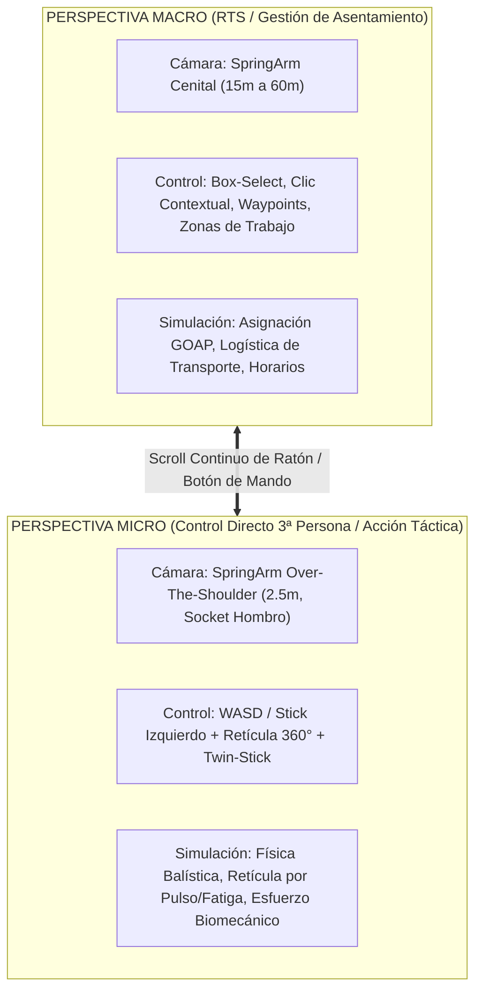

### 16.1 Transición Cinemática Continua (`SpringArm3D`)
* **Sin Pantallas de Carga ni Modos Aislados:** El paso entre perspectivas se realiza mediante un `SpringArm3D` dinámico con interpolación suave:
  * **Rango Micro ($2.5\text{ m} \le d \le 6.0\text{ m}$):** Anclaje al hombro derecho del esqueleto MakeHuman. Ángulo de inclinación horizontal libre con el ratón o stick derecho. Retícula activa y telemetría de salud (`BodySystem`).
  * **Rango Intermedio / Táctico ($6.0\text{ m} < d \le 18.0\text{ m}$):** Vista isométrica clásica de combate táctico.
  * **Rango Macro ($18.0\text{ m} < d \le 60.0\text{ m}$):** La cámara se orienta a $65^\circ$ cenital, se libera el cursor del ratón, y el esquema de entrada cambia al gestor de selección de cuadrillas y planos de obra.
* **Coherencia Balística y de Daño Absoluta:**
  * No existen dos sistemas de combate. Cada disparo (sea del jugador en 3ª persona o de un guardia asignado en RTS) instancia un proyectil físico con masa, calibre, caída de gravedad y vector de penetración.
  * Si el guardia dispara en RTS, la dispersión del proyectil es dictada por su estamina actual, dolor y nivel de pánico de su `BodySystem`.

### 16.2 Posesión y Desposesión de Agentes (Seamless GOAP Handover)
* Cuando el jugador aleja la cámara a RTS, el avatar que controlaba no se congela: su cerebro de IA (**Goal-Oriented Action Planning**) toma el contexto inmediato (ej. buscar cobertura si hay disparos, recargar arma, continuar serrando el tronco asignado).
* Al hacer doble clic sobre cualquier superviviente de la colonia, la cámara desciende a su espalda y el jugador toma posesión física directa de su cuerpo y herramientas.

---

## 17. 🔨 Paridad Universal de Fabricación, Deconstrucción & Flujo de Calidad ($q$-Flow)

> **Regla de Oro:** *"Si existe en el mundo físico, el jugador puede construirlo; y si lo encuentra en el mundo, puede deconstruirlo en sus materiales originales."*

Cero objetos estáticos "de escenografía". Cada mueble, pared, barricada, herramienta o vehículo comparte la misma estructura de datos de ensamblaje (`ItemData` / `ModularStructureData`).

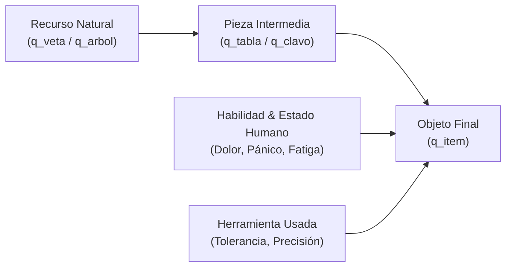

### 17.1 La Lista de Materiales (Bill of Materials - BOM)
Todo objeto posee una receta reversible:
* **Masa y Volumen Sumatorios:** La masa del ítem es exactamente la suma de las masas de sus componentes menos la merma de corte o forja. Afecta directamente la fatiga biomecánica del `BodySystem`.
* **Dureza Física (Escala Rockwell / Mohs):** Determina deformaciones y rebotes de impacto.
* **Desguace Realista:** Si el jugador encuentra una mesa de roble en una casa abandonada, puede desarmarla con martillo y palanca para recuperar clavos de forja y tablones con su desgaste correspondiente.

### 17.2 La Ecuación del Flujo de Calidad ($q$-Flow)
La calidad ($q \in [0, 100]$) se propaga en cascada matemática:
$$q_{\text{resultado}} = \left( \sum_{i=1}^{n} w_i \cdot q_{\text{material}_i} \right) \times \text{FactorHabilidad}(\text{Humano}) \times \text{Precisión}(\text{Herramienta})$$

* **Techo Físico (Hard-Cap):** Un maestro armero no puede fabricar un cañón de precisión $q90$ a partir de chatarra oxidada $q15$. La pureza del material impone el límite superior.
* **Cuello de Botella Biológico (Soft-Cap):** Si un superviviente inexperto, con hipotermia en las manos o pánico severo intenta forjar acero de alta calidad, el ítem resultante saldrá deforme, desbalanceado o agrietado ($q20\text{--}30$).
* **Impacto Jugable del $q$:** En una barricada, mayor $q$ significa uniones estancas sin holguras (aislamiento térmico contra viento invernal) y el triple de durabilidad mecánica ante empujes de zombis.

---

## 18. 🌍 Sustrato Espacial del Terreno, Senderos Dinámicos & Tafonomía

El terreno no es una malla poligonal muerta: es una matriz de datos viva (`WorldSubstrateGrid`) que responde al clima, al tránsito de cuerpos y a la materia orgánica.

### 18.1 Compactación Mecánica y Senderos de Deseo (*Desire Paths*)
* Cada paso de un humano, zombi o rueda de vehículo transfiere energía mecánica al suelo:
  $$\text{Compaction}[x, z] += \text{MasaTotal\_kg} \times 0.005$$
* **Transición Emergente:**
  * Al superar $\text{Compaction} > 40$: La hierba muere por asfixia radicular.
  * Al superar $\text{Compaction} > 80$: Se forma un **sendero de tierra batida** liso y firme.
  * *Efecto Jugable:* Los supervivientes se mueven $+15\%$ más rápido por senderos compactados con menor costo metabólico. **El campamento dibuja sus propios caminos orgánicos por las rutas más transitadas sin necesidad de que el jugador construya calzadas a mano.**

### 18.2 Lodo Dinámico e Hidrología
* La lluvia satura la celda (`Moisture[x, z]`).
* Cuando una celda combina **Alta Compactación + Alta Humedad**, su sustrato muta automáticamente a `EnvironmentSystem.SubstrateType.THICK_MUD`:
  * Adhiere de inmediato $+1.8\text{ kg}$ de lastre a las botas del personaje.
  * Reduce la tracción a $0.4\times$ y triplica el riesgo de resbalones y lesiones articulares en tobillos y rodillas.

### 18.3 Tafonomía Cadavérica (Necro-Simulación en 3 Fases)
1. **Fase Fresca ($0\text{--}24\text{ h}$):** La sangre líquida emite feromonas que atraen cánidos salvajes e infectados cercanos.
2. **Fase Hinchada y Putrefacción Activa ($1\text{--}7\text{ días}$):**
   * Bacterias anaeróbicas generan gases y hedor penetrante.
   * **Vector de Hedor por Viento:** El cadáver emite partículas que viajan en la dirección del vector de viento activo. Si el viento sopla hacia el campamento, genera náuseas, pérdida de apetito y depresión psicológica en los supervivientes.
   * Riesgo biológico de cólera y diarrea infecciosa si el cuerpo está cerca de fuentes de agua potable.
3. **Fase de Lixiviación y Esqueleto ($2\text{--}12\text{ semanas}$):**
   * Los fluidos se filtran al sustrato circundante. La toxicidad inicial esteriliza el suelo local.
   * Meses después, la descomposición aporta nitrógeno orgánico al terreno, provocando un rebrote denso de maleza y ortigas sobre el lugar de la muerte.
   * **Optimización en Motor:** A los 3 segundos de morir, la física de muñeco de trapo (*ragdoll*) se desactiva y el cadáver se convierte en una malla estática instanciada con parámetros de shader (`decay_progress`), permitiendo miles de cuerpos sin impacto en la CPU.

---

## 19. 🏛️ Verticalidad Real, Construcción Modular y Sub-niveles (Sótanos)

Para garantizar que cada edificio preexistente o construido sea 100% transitable sin pantallas de carga:

```
[ Z = +2 ]  Buhardilla / Techo a dos aguas (Francotiradores, almacén seco)
[ Z = +1 ]  Planta Alta / Dormitorios (Vigas de madera que crujen al pisar)
[ Z =  0 ]  Planta Baja / Salón y Accesos (Puertas reforzadas y ventanas)
[ Z = -1 ]  SÓTANO / Búnker excavado (Aislamiento acústico, microclima fresco)
```

### 19.1 Paridad Estructural de Edificaciones
* Toda pared se compone de: **Esqueleto estructural** (postes 2x4s de pino o metal), **Aislamiento intermedio** (lana, barro o aire), y **Revestimiento** (tablones, chapas o yeso).
* Si una horda rompe 3 postes estructurales consecutivos de la planta baja, la viga maestra cede y el piso superior se derrumba por gravedad.

### 19.2 Visibilidad e Interiores en 3ª Persona y RTS
* **En 3ª Persona (Wall Dither Fade):** Las paredes o techos que se interponen entre la lente de la cámara y el cuerpo del personaje no bloquean la visión ni acercan la cámara bruscamente: se vuelven semitransparentes mediante un shader de ruido dither (*screen-door transparency*).
* **En RTS (Plano de Corte `active_floor_cutoff_height`):** Al descender un superviviente al sótano o entrar a la planta baja, los techos y pisos superiores se descartan mediante shader de plano de corte instantáneamente, permitiendo comandar el interior con claridad cenital.

### 19.3 Microclima y Acústica en Sótanos
* **Termodinámica:** En verano, el calor sube al ático ($>35^\circ\text{C}$); el sótano permanece a $14^\circ\text{C}$ constante, funcionando como almacén frigorífico natural para alimentos perecederos.
* **Aislamiento Acústico:** Las paredes de tierra compactada del sótano amortiguan el $95\%$ del sonido generado dentro, convirtiéndolo en el refugio idóneo para sobrevivir a noches de asedio en absoluto silencio.

---

## 20. 👁️ Táctica de Infiltración y Reconocimiento: Rendijas y Auscultación Acústica (Oído en la Pared)

Heredando la tensión táctica de la saga *Commandos (Pyro Studios)*, abrir una puerta a ciegas en un entorno infestado es un riesgo mortal. El reconocimiento previo a través de rendijas, cerraduras, huecos de barricadas y la auscultación de paredes es una mecánica central de supervivencia.

```
       [ OJO DEL SUPERVIVIENTE ]                      [ OÍDO EN LA PARED ]
                  \                                           │
                   \   (d = Distancia al orificio)            │ (Acoplamiento acústico directo)
                    \                                         ▼
════════════════════[ RENDIJA (w = Ancho) ]════════════════[ PARED ESTRUCTURAL ]════════════════
                     /                                        │
                    /   Ángulo de Visión: θ = 2 · arctan(w / 2d)  │ Ondas mecánicas (Vibroacústica)
                   /                                          ▼
      [ INTERIOR DE LA HABITACIÓN ]               [ PASOS, RESPIRACIONES & GRUÑIDOS ]
```

### 20.1 Óptica de Apertura (*Pinhole Optics*)
* El ángulo de visión útil ($\theta$) dentro de la habitación es inversamente proporcional a la distancia del ojo al orificio:
  * A $1.0\text{ m}$ de la puerta: El campo visual es un hilo de apenas $2^\circ$.
  * Pegando la cara a la madera ($d = 3\text{ cm}$): El cono se abre a más de $50^\circ$, revelando zombis, botín y trampas en el interior.

### 20.2 Implementación en 3ª Persona vs. RTS
* **En 3ª Persona:**
  * Al interactuar sigilosamente con la puerta, la cámara interpola suavemente hasta el socket de los ojos del esqueleto MakeHuman.
  * Se activa una viñeta orgánica de madera astillada con desenfoque de profundidad de campo (*Depth of Field Bokeh*).
  * **Portal Acústico (Audio Portal):** La atenuación y el filtro pasa-bajos de la puerta cerrada se abren temporalmente, permitiendo escuchar pasos, crujidos y gruñidos con espacialidad 3D nítida antes de entrar.
* **En RTS (Cono de Niebla de Guerra):**
  * La orden táctica *"Espiar por rendija"* hace que el superviviente se agache junto al marco.
  * En lugar de cambiar de cámara, el motor proyecta una **cuña translúcida en la Niebla de Guerra interior**, revelando las siluetas de las entidades presentes dentro de esa línea de visión geométrica.

### 20.3 Riesgo Bidireccional y Saeteras de Combate
* **Fuga de Luz y Olor:** Encender la linterna del lado exterior proyecta un haz de luz visible a través de la rendija que alerta a zombis fotosensibles. El hedor corporal o el sangrado traspasa el orificio por convección de aire.
* **Saeteras y Troneras:** Los huecos de $3\text{--}5\text{ cm}$ entre tablones de una barricada permiten al jugador empuñar lanzas, destornilladores o armas cortas para **eliminar zombis que empujan la barricada desde la seguridad del interior**, con el riesgo físico de que el arma quede atascada en el cráneo del infectado.

---

### 20.4 Auscultación Estructural: Escuchar con el Oído en la Pared

Cuando no existen rendijas o la puerta es completamente ciega, el jugador puede aprovechar la **conducción acústica por contacto sólido**.

#### A. Física de Transmisión Sólida (Vibroacústica de Contacto)
* El sonido en el aire pierde energía al chocar contra una pared debido al desajuste de impedancia acústica. Sin embargo, al apoyar físicamente la oreja y el cartílago contra el material de la pared, se produce **acoplamiento acústico directo**:
  * Las vibraciones mecánicas generadas dentro de la habitación (pisadas sobre madera, arrastre de pies, respiraciones asmáticas de zombis, goteos de tuberías o zumbido de generadores) se transmiten por vía ósea y tisular directamente al tímpano.
* **Comportamiento según el Material de la Pared (Ligado a Paridad Estructural):**
  * *Tabique hueco de madera / yeso (Drywall con montantes de 2x4s):* Excelente transmisión de ruidos aéreos y pasos ligeros.
  * *Muro de ladrillo macizo o piedra:* Bloquea las voces y respiraciones, pero transmite con gran fidelidad impactos contundentes (golpes, forcejeos o zombis arañando la pared).
  * *Pared con Aislamiento Acústico (Lana de roca/vidrio):* Absorbe hasta el $90\%$ de las vibraciones, volviendo la habitación un enigma acústico.

#### B. Gameplay Inmersivo en 3ª Persona (Micro)
* **Animación y Postura:** El superviviente se acerca a la pared, ladea la cabeza y presiona la oreja contra la superficie (`Action_Listen_Wall`).
* **Diseño Sonoro Dinámico:**
  * El audio ambiental exterior se atenúa en un $-80\%$.
  * Se activa el audio directo del cuarto interior, ecualizado con realce de frecuencias medias y bajas ($80\text{--}800\text{ Hz}$).
  * **Interferencia Cardiovascular:** El sonido de los propios latidos cardíacos (`b.cardio.heart_rate_bpm`) y la respiración del superviviente resuenan en el canal: si el personaje está en pánico o exhausto por correr, su propia taquicardia le impide escuchar con claridad el interior.
* **Feedback Visual de Sonido:** Pulsos concéntricos de ondas translúcidas (*sound ripples*) sobre la pared indican la intensidad del ruido interior y dan una estimación de la cantidad de entidades ("Calma absoluta", "1-2 presencias arrastrándose", "Actividad frenética / Horda").

#### C. Gameplay Táctico en RTS (Macro)
* **Orden Táctica:** *"Auscultar pared / Inspeccionar acústicamente"*.
* El superviviente asignado se desplaza a la pared seleccionada y escucha durante 3 segundos.
* En la niebla de guerra de la habitación contigua aparecen marcadores de audio parpadeantes (`🔊 ?`) con un área de incertidumbre radial que refleja la posición estimada de los zombis o supervivientes hostiles.

#### D. Riesgos Físicos, Psicológicos y Vulnerabilidad
* **Pérdida de Visión Trasera:** Al pegar la cara y oreja a la pared, el cono visual trasero queda en punto ciego y la atención auditiva está fijada en el muro; el personaje es extremadamente vulnerable a emboscadas por la espalda.
* **Sobresalto Agudo e Impacto Psicológico (Startle Reflex & Pánico):** Si un infectado embiste o golpea repentinamente la pared justo donde el superviviente tiene la oreja apoyada en pleno silencio, el efecto no es un tinnitus sordo (reservado para detonaciones de armas de fuego o explosiones), sino un **shock neurofisiológico y psicológico inmediato**:
  * **Pico Violento de Taquicardia:** La descarga súbita de adrenalina dispara el ritmo cardíaco (`b.cardio.heart_rate_bpm` salta instantáneamente de reposo a más de $145\text{ BPM}$) y el medidor de pánico sube al $100\%$ de golpe.
  * **Reflejo Involuntario de Sobresalto:** El personaje retrocede espasmódicamente tropezando hacia atrás un paso o dos, despegándose de la pared.
  * **Pérdida de Motricidad Fina (*Fumbling*):** El temblor muscular por el susto tiene una alta probabilidad de provocar que el personaje suelte torpemente el arma, cuchillo o linterna que lleve en la mano al suelo (`Action_Fumble_Drop`), generando un tintineo metálico que alerta aún más a los zombis.
  * **Contusión Craneofacial Menor:** Solo si el tabique es de madera delgada o yeso y se deforma físicamente hacia adentro, se produce una molestia o hematoma leve en la oreja o pómulo, pero la verdadera penalización es la pérdida total de compostura, la hiperventilación y el tiempo que tarda el personaje en calmar su pulso.

---

## 21. 🏘️ Autonomía Comunitaria y Asentamiento: Arquitectura Smart Objects & POPs

Para que el asentamiento en modo RTS se sienta como una comunidad viva sin requerir microgestión constante ni miles de líneas de código espagueti por NPC, el juego adopta la **arquitectura de Smart Objects de *The Sims* (Will Wright)** combinada con el **modelo de población y redes de suministro discretas de *SimCity (GlassBox Engine)* y juegos de estrategia tipo POPs**.

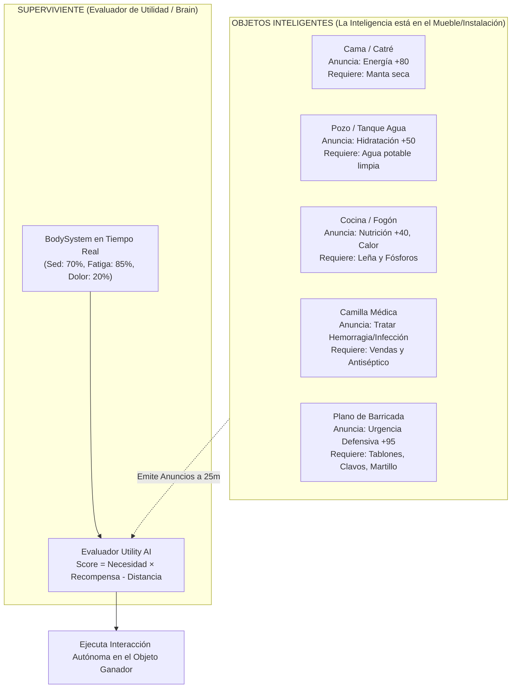

### 21.1 La Arquitectura de "Smart Objects" (Inspiración Will Wright / *The Sims*)
En lugar de programar cada comportamiento dentro del agente (`SurvivorAI`), **los objetos del entorno emiten anuncios (*Advertisements*)** sobre qué necesidades biológicas pueden satisfacer:

1. **Emisión de Necesidades (Affordances):**
   * Un **Catré de madera**: Anuncia `Restaurar Energía (+80)`; exige ranura libre y techo sin goteras.
   * Una **Olla de guisado en el fogón**: Anuncia `Nutrición (+600 kcal)`, balance proteico y calor corporal.
   * Una **Barricada dañada**: Anuncia `Prioridad de Fortificación`; exige herramientas y tablones.
2. **El Evaluador del NPC (Utility AI / Motive Scoring):**
   * El NPC no tiene un árbol rígido. Simplemente lee su `BodySystem` y evalúa todos los anuncios de los objetos a su alrededor:
     $$\text{Score}(\text{Objeto}) = \left( \text{Déficit}(\text{Necesidad}) \times \text{Beneficio}(\text{Objeto}) \right) - \left( \text{DistanciaMetros} \times \text{GastoMetabólico} \right)$$
   * El colono camina hacia el objeto con mayor puntuación y ejecuta la máquina de estados que **el propio objeto le ordena hacer** (ej. acostarse en la cama o martillar la viga).
3. **Extensibilidad Total en Godot 4:**
   * Cualquier nuevo elemento (trampas de caza, letrinas, mesas de recarga de munición o destiladores de alcohol) se crea como un `Node3D` con un componente `SmartObjectComponent`. Todos los supervivientes del mundo saben utilizarlo al instante sin modificar una sola línea del script del NPC.

---

### 21.2 Modelo Demográfico de POPs (Population Units) en Modo RTS
Los supervivientes no son números abstractos; son **unidades POPs con biometría, identidad y moral psicológica**:

* **Canasta Diaria de Supervivencia por POP:**
  * $2.5\text{ L}$ de agua dulce libre de bacterias (patógenos provocan diarrea infecciosa que deshidrata en 48 horas).
  * $2.200\text{ kcal}$ con aporte mínimo de $60\text{ g}$ de proteína para evitar catabolismo muscular.
  * 1 espacio de descanso seco y térmicamente aislado ($18\text{--}22^\circ\text{C}$).
* **Moral Comunitaria y Patologías Sociales:**
  * Si la base no cuenta con letrinas cavadas, los desechos humanos acumulan moscas y disparan el riesgo de cólera.
  * Si hay cadáveres de zombis pudriéndose en el perímetro (Sección 18.3) y el viento empuja el hedor hacia las habitaciones, la moral de los POPs colapsa: surgen peleas internas, desobediencia de órdenes de guardia, robos de comida o suicidios por depresión extrema.

---

### 21.3 Redes Físicas de Suministro (Modelo *GlassBox* / *SimCity*)
Los servicios de la base no son porcentajes mágicos; son **redes de paquetes físicos discretos**:

1. **Red Hidráulica:**
   * Colectores pluviales en tejados conducen agua mediante cañerías de PVC por gravedad hacia tanques de decantación y filtros de arena/carbón activado.
   * Si una bala o zombi perfora una cañería en el patio, el agua se derrama creando un lodazal dinámico (`THICK_MUD`) y la cocina comunitaria pierde presión.
2. **Red Eléctrica:**
   * Un generador diésel produce $3.000\text{ W}$. Los cables de cobre canalizan Watts hacia bombillas, reflectores defensivos y un refrigerador médico para conservar penicilina y plasma sanguíneo.
   * Si el consumo simultáneo supera los $3.000\text{ W}$, los disyuntores saltan por sobrecarga térmica y la base queda sumida en la oscuridad más absoluta durante un ataque nocturno.

---

### 21.4 Sinergia Jugable Micro-Macro
* **En 3ª Persona (Micro):** El jugador encarna a un colono y vive la experiencia directa: abre la alacena para comer con animación física, se cura una laceración en la camilla o coloca leña en la estufa para combatir la hipotermia.
* **En RTS (Macro):** El jugador actúa como el arquitecto de la comunidad: levanta dormitorios, planifica redes de agua y asigna horarios de guardia; los supervivientes habitan ese entorno con **autonomía natural e inteligente basada en sus necesidades fisiológicas reales**.

---

## 22. 📡 Telecomunicaciones RF, Redes de Energía y Separación de Capas (Ítem vs. Simulación vs. Humano)

Inspirado en la física real de radiocomunicaciones y redes eléctricas de asentamientos, los sistemas tecnológicos no se gestionan mediante contadores abstractos, sino mediante una estricta **separación tripartita de responsabilidades**:

1. **Capa Ítem (`ItemData` / `ItemComponent`):** Almacena el estado físico local puro (voltaje, frecuencia, vatios, carga restante, masa, durabilidad).
2. **Capa Simulación (`SimulationSystem` / `WorldGrid`):** Resuelve la física ambiental, propagación de ondas de radiofrecuencia (RF), atenuación por orografía/muros, y el balance del grafo de circuitos eléctricos.
3. **Capa Humano (`BodySystem` / `SensorySystem`):** Procesa la interacción biomecánica (lastre por transportar baterías pesadas, fatiga), percepción sensorial (auriculares vs. altavoz que alerta zombis), y riesgos de electrocución/shock cardíaco.

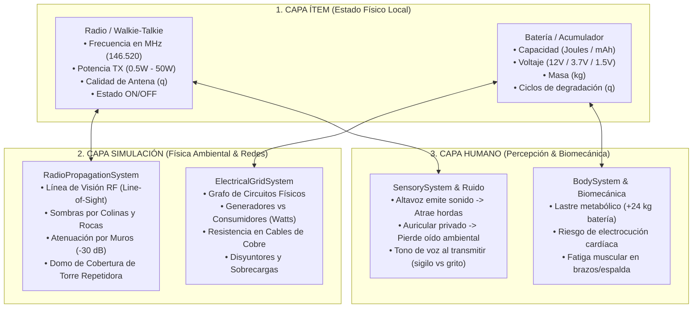

---

### 22.1 Visualización de la Transición Micro-Macro (Mockups Conceptuales)

#### A. Vista Macro: RTS / Gestión de Asentamiento / Cobertura RF y Red Eléctrica

*En la perspectiva superior isométrica se proyecta el domo de propagación de radiofrecuencia (azul) emitido por la torre repetidora de la base, el tendido de cables de cobre (amarillo) desde el generador diésel hacia los reflectores perimetrales, y las huellas de barro y pisoteo orgánico entre cabañas.*

#### B. Vista Micro: 3ª Persona Over-the-Shoulder / Dispositivos Diegéticos

*Al descender al hombro del superviviente, la interfaz se vuelve diegética: el walkie-talkie portátil muestra en su pantalla LCD la misma frecuencia sintonizada (146.520 MHz), batería (38%) y barras de señal, mientras por la ventana se divisa la torre y la iluminación del campamento que gestionabas desde el cielo.*

---

### 22.2 Sistema de Radiocomunicaciones y Frecuencias (RF Mesh)

#### A. Propiedades Físicas del Dispositivo (Capa Ítem)
* **Banda y Frecuencia de Trabajo:** Sintonización analógica en MHz (ej: VHF 136–174 MHz, UHF 400–470 MHz, CB 27 MHz).
* **Potencia de Transmisión (TX Power):**
  * *Walkie-talkie portátil:* 0.5 W a 5 W (alcance táctico local, bajo consumo de batería).
  * *Estación base fija de campamento:* 25 W a 50 W (alcance comarcal masivo, requiere conexión a red eléctrica de 12V/110V).
* **Calidad de Antena ($q$):** Antenas de goma rústicas ($q20$, alta pérdida por desacople) vs. antenas Yagi direccionales o dipolos sintonizados en mástil ($q90$).
* **Ranura de Alimentación:** Compartimento de batería intercambiable (pilas AA o paquete recargable Li-ion).

#### B. Física de Propagación y Atenuación Ambiental (Capa Simulación)
* **Línea de Visión Óptica y de Radio (LOS / Line-of-Sight):** Las ondas VHF/UHF viajan en línea recta y sufren sombras de radio tras colinas rocosas o bosques densos.
* **Atenuación Estructural:**
  * Aire libre: Atenuación en espacio libre ($20 \log_{10}(d)$).
  * Bosque denso / Vegetación húmeda: $-6\text{ dB}$ a $-12\text{ dB}$ por absorción de agua en hojas.
  * Muros de hormigón y sótanos ($Z = -1$): $-25\text{ dB}$ a $-35\text{ dB}$ (la señal se degrada a estática pura; obliga a salir al exterior o subir al tejado para comunicarse).
* **Torres Repetidoras en Asentamientos:**
  * Instalar una antena elevada en una torre de vigilancia eleva el radiohorizonte:
    $$d_{\text{horizonte\_km}} \approx 3.57 \cdot \sqrt{h_{\text{antena\_m}}}$$
  * Permite cubrir un radio de más de $15\text{ km}$ a la redonda, sirviendo de enlace para todas las patrullas en el exterior.
* **Clima:** Tormentas eléctricas y lluvias torrenciales aumentan el piso de ruido (*noise floor*), reduciendo la relación señal/ruido (SNR).

#### C. Interacción y Riesgos Biomecánicos (Capa Humano)
* **Modo Altavoz vs. Auriculares:**
  * *Altavoz activo:* Las voces entrantes y la estática de radio emiten ondas de sonido en el mundo $\to$ **atraen zombis cercanos**.
  * *Auriculares tácticos:* El audio es privado y silencioso para el exterior, pero el superviviente pierde oído ambiental (atenúa pasos de infectados acechando por detrás).
* **Transmisión de Voz y Detección:** Hablar por el micrófono genera un radio de ruido proporcional al tono de voz del jugador o NPC (susurrar en sigilo vs. gritar pidiendo auxilio).

---

### 22.3 Sistema de Energía, Baterías y Red Eléctrica

#### A. Baterías y Almacenamiento Químico (Capa Ítem)
* **Voltajes y Químicas Reales:**
  * *Baterías de plomo-ácido de automoción:* $12\text{V}$, gran masa ($18\text{--}25\text{ kg}$), alta corriente de arranque, ideales para estaciones fijas de campamento o vehículos.
  * *Celdas cilíndricas 18650 Li-ion:* $3.7\text{V}$, $2.500\text{ mAh}$, excelente densidad energética, usadas en linternas tácticas y walkie-talkies modernos.
  * *Pilas alcalinas / NiMH (AA / AAA):* $1.5\text{V} / 1.2\text{V}$, desechables o recargables lentas.
* **Tasa de Descarga y Joules:** Cada dispositivo drena Joules por segundo ($P = V \cdot I$). Si la batería llega a $0\text{ J}$, el aparato se apaga.
* **Degradación Química ($q$-Cycles):** Cada ciclo de recarga o descarga profunda degrada la capacidad máxima del acumulador.

#### B. La Red Eléctrica del Asentamiento (Capa Simulación)
* **Grafo de Red Eléctrica Física:**
  * *Nodos Generadores:* Generador diésel ($3.5\text{ kW}$), generador de gasolina portátil ($1.2\text{ kW}$), paneles fotovoltaicos solares ($250\text{ W}$ pico por panel, variables por nubosidad y ángulo solar).
  * *Nodos de Almacenamiento:* Banco de baterías de ciclo profundo con inversor DC/AC ($12\text{V} \to 110\text{V}/220\text{V}$).
  * *Aristas de Tendido:* Cables de cobre con calibre real (AWG) y resistencia eléctrica ($\Omega$). Si un cable se sobrecarga, se recalienta y puede iniciar un incendio en paredes de madera.
  * *Nodos Consumidores:* Focos de empalizada ($150\text{ W}$ c/u), refrigerador médico de antibióticos y plasma ($200\text{ W}$ continuo), estación de radio fija ($60\text{ W}$ en transmisión), taller de recarga de baterías ($500\text{ W}$).
* **Sobrecarga y Disyuntores Térmicos:**
  * Si $\sum P_{\text{consumida}} > P_{\text{generada}}$, los disyuntores térmicos saltan por protección, apagando la base de inmediato. Si no hay disyuntor instalado, el alternador del generador se quema.

#### C. Biomecánica y Riesgos en el Superviviente (Capa Humano)
* **Masa y Lastre de Transporte:**
  * Una batería de camión pesa $24\text{ kg}$. Llevarla en el inventario o en las manos incrementa drásticamente el peso total del cuerpo, disparando el gasto calórico de marcha en `BodySystem` y provocando fatiga muscular rápida en brazos y espalda.
* **Riesgo de Electrocución y Paro Cardíaco:**
  * Manipular cableado eléctrico energizado con manos mojadas o bajo lluvia torrencial induce un paso de corriente a través del tórax:
    * Genera quemaduras eléctricas cutáneas en las manos.
    * Afecta directamente al `cardiovascular_system`, con riesgo inminente de **fibrilación ventricular y paro cardíaco agudo** si no se corta la energía de la llave maestra antes de reparar.

---

### 22.4 Matriz de Decisión Arquitectónica (Guía Rápida para el Motor)

| Pregunta de Diseño | ¿A qué capa pertenece? | Clase Responsable en Godot 4 |
| :--- | :--- | :--- |
| ¿Qué frecuencia tiene sintonizada la radio? | **ÍTEM** | `RadioComponent.gd` (en `ItemData`) |
| ¿Cuánta carga en Joules le queda a la pila? | **ÍTEM** | `BatteryComponent.gd` (en `ItemData`) |
| ¿Puede pasar la señal a través de esta colina? | **SIMULACIÓN** | `RadioPropagationSystem.gd` |
| ¿Tiene suficiente potencia el generador para la luz? | **SIMULACIÓN** | `ElectricalGridSystem.gd` |
| ¿Cuánto pesa la batería y cuánto cansa al colono? | **HUMANO** | `BodySystem.gd` (`exertion_factor`) |
| ¿El sonido del altavoz atrae a los zombis cercanos? | **HUMANO / ENTORNO** | `NoiseEmitter.gd` $\to$ `SensorySystem.gd` |
| ¿El colono se electrocuta al reparar bajo la lluvia? | **HUMANO** | `cardiovascular_system.gd` |
