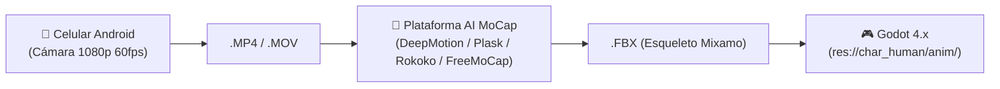

# 🎬 Guía Maestra de Animaciones & Captura de Movimiento (MoCap) con IA
## Para PC (Windows / Web) y Celulares Android (Sin Ecosistema Apple)

> **Objetivo:** Esta guía detalla la lista completa de animaciones que necesita nuestro juego de supervivencia zombi para respaldar el motor biológico (*BodySystem*), junto con las mejores herramientas web, de escritorio y aplicaciones de Android para grabarte a ti mismo actuando y convertirlas en animaciones 3D (`.FBX`) listas para Godot 4.x.

---

## 📑 Tabla de Contenidos
1. [Catálogo Completo de Animaciones Requeridas](#1-catálogo-completo-de-animaciones-requeridas)
   - [A. Traumatología & Locomoción Dañada](#a-traumatología--locomoción-dañada)
   - [B. Procedimientos Médicos & Primeros Auxilios](#b-procedimientos-médicos--primeros-auxilios)
   - [C. Fisiología, Termorregulación & Fatiga](#c-fisiología-termorregulación--fatiga)
   - [D. Psicología, Pánico & Torpeza Motriz](#d-psicología-pánico--torpeza-motriz)
   - [E. Rutinas de Supervivencia & Descanso](#e-rutinas-de-supervivencia--descanso)
   - [F. Cinemática Zombi & Mutilaciones](#f-cinemática-zombi--mutilaciones)
2. [Herramientas de IA para Grabarte a Ti Mismo (Video-to-3D)](#2-herramientas-de-ia-para-grabarte-a-ti-mismo-video-to-3d)
   - [1. DeepMotion (Animate 3D)](#1-deepmotion-animate-3d--la-opción-n1-web--android)
   - [2. Plask Motion](#2-plask-motion--editor-en-navegador-para-pc)
   - [3. Rokoko Vision (Multi-Cámara)](#3-rokoko-vision--rokoko-studio-para-pc)
   - [4. FreeMoCap (100% Gratis / Open-Source Local)](#4-freemocap--100-gratis-open-source-para-pc)
   - [5. Cascadeur (Física Asistida por IA para PC)](#5-cascadeur--limpieza-de-física-y-peso-en-pc)
3. [Guía de Grabación en Casa con Android](#3-guía-de-grabación-en-casa-con-android)
4. [Pipeline de Integración en Godot 4.x](#4-pipeline-de-integración-en-godot-4x)

---

## 1. Catálogo Completo de Animaciones Requeridas

Para que la simulación biológica de `BodySystem` tenga impacto visual, necesitamos las siguientes animaciones. Puedes **buscarlas en Mixamo** o **grabarlas tú mismo** usando la descripción de actuación.

### A. Traumatología & Locomoción Dañada

| Nombre en Godot | Condición de Activación en Código | Búsqueda en Mixamo / Librerías | Guía de Actuación (Si te grabas tú) |
| :--- | :--- | :--- | :--- |
| `Walk_Limp_Left` | Dolor en pierna/pie izq. $>25$ o fractura | **`Injured Walk`** o **`Limping`** | Camina apoyando muy poco el talón izquierdo, flexionando la cadera y ladeando el torso al apoyar la pierna sana. |
| `Walk_Limp_Right` | Dolor en pierna/pie der. $>25$ o fractura | **`Injured Walk Right`** o **`Left Turn Limp`** | Mismo patrón de cojera pero descargando el peso sobre la pierna izquierda. |
| `Walk_Injured_Torso` | Laceración profunda en abdomen o tórax | **`Wounded Walk`** o **`Walking Injured`** | Camina encorvado hacia adelante, con una mano presionando el costado o el abdomen con dolor visible. |
| `Locomotion_Stumble` | Volemia $<3000\text{ mL}$ o temp $>40^\circ\text{C}$ | **`Drunk Walk`**, **`Stumble`** o **`Dizzy Walk`** | Pasos vacilantes, pérdida momentánea del equilibrio, cabeza gacha y balanceo errático de brazos. |
| `Collapse_Faint` | Shock hipovolémico severo ($<2500\text{ mL}$) | **`Passing Out`**, **`Faint`** o **`Fall Backward`** | Desplome sin fuerza: las rodillas ceden primero, el cuerpo cae pesado hacia atrás o de lado sin poner las manos. |

---

### B. Procedimientos Médicos & Primeros Auxilios

| Nombre en Godot | Condición de Activación en Código | Búsqueda en Mixamo / Librerías | Guía de Actuación (Si te grabas tú) |
| :--- | :--- | :--- | :--- |
| `Action_Bandage_Arm` | Vendar / suturar brazo o mano | **`First Aid`**, **`Bandaging`** o **`Checking Arm`** | De pie o agachado, sostén el antebrazo con la otra mano simulando enrollar una venda apretada alrededor. |
| `Action_Bandage_Leg` | Vendar / entablillar pierna o pie | **`Sitting First Aid`** o **`Bandaging Leg`** | Sentado en el suelo con una pierna estirada, inclínate hacia adelante manipulando el tobillo o rodilla. |
| `Action_Tourniquet` | Colocar torniquete arterial ($<180\text{ s}$) | **`Self Treatment`** o **`Applying Tourniquet`** | Pasa una tira o cincha por encima del bíceps o muslo y gira una varilla imaginaria con fuerza para cortar el flujo. |
| `Idle_Wounded_Arm` | Fractura o quemadura en brazo en reposo | **`Holding Injured Arm`** o **`Pain Gesture`** | De pie en reposo, sostén el codo/antebrazo herido pegado al pecho con expresión de tensión. |

---

### C. Fisiología, Termorregulación & Fatiga

| Nombre en Godot | Condición de Activación en Código | Búsqueda en Mixamo / Librerías | Guía de Actuación (Si te grabas tú) |
| :--- | :--- | :--- | :--- |
| `Idle_Exhausted_Pant` | Estamina $0\%$ o pulso $>175\text{ BPM}$ | **`Panting`**, **`Catching Breath`** o **`Tired Idle`** | Detente, apoya las dos manos sobre las rodillas, encorva la espalda y respira profundamente agitando los hombros. |
| `Idle_Shivering` | Temperatura central $<35.5^\circ\text{C}$ (`is_shivering`) | **`Shivering`**, **`Cold Idle`** o **`Freezing`** | De pie abrazándote a ti mismo con los brazos cruzados, temblando con sacudidas rápidas e involuntarias. |
| `Action_Wipe_Sweat` | Temperatura $>38.8^\circ\text{C}$ o sudor masivo | **`Wiping Sweat`**, **`Hot Idle`** o **`Wipe Forehead`** | Levanta el antebrazo o dorso de la mano y pásalo por la frente con gesto de sofoco y cansancio. |
| `Action_Cough` | Inhalación de humo o daño torácico | **`Coughing`**, **`Choking`** o **`Heavy Cough`** | Tose fuerte tapándote la boca con el codo, flexionando el torso en cada sacudida. |

---

### D. Psicología, Pánico & Torpeza Motriz

| Nombre en Godot | Condición de Activación en Código | Búsqueda en Mixamo / Librerías | Guía de Actuación (Si te grabas tú) |
| :--- | :--- | :--- | :--- |
| `Idle_Panic_Frantic` | Pánico $>70\%$ ante horda | **`Scared`** o **`Terrified Looking Around`** | Posición semi-agachada tensa, mirando rápido de izquierda a derecha con manos abiertas a la altura del pecho. |
| `Action_Fumble_Drop` | Fallo de manipulación por estrés (*Fumble*) | **`Fumbling Drop`** o **`Nervous Tremble`** | Intenta recargar o guardar algo, tiemblan las manos y haz el gesto de que se te resbala algo al suelo. |
| `Action_Tremble_Hands` | Adrenalina / Manos temblorosas | **`Trembling Hands`** o **`Shock Idle`** | Mira tus propias manos levantadas frente al pecho mientras tiemblan visiblemente. |

---

### E. Rutinas de Supervivencia & Descanso

| Nombre en Godot | Condición de Activación en Código | Búsqueda en Mixamo / Librerías | Guía de Actuación (Si te grabas tú) |
| :--- | :--- | :--- | :--- |
| `Action_Sit_Ground` | Iniciar descanso para recuperar estamina | **`Sitting On Ground`** | Transición fluida de estar de pie a sentarse con las piernas cruzadas o estiradas. |
| `Action_Get_Up` | Finalizar descanso | **`Sit To Stand`** | Incorporarse desde el suelo apoyando una mano y levantando la cadera. |
| `Action_Drink_Bottle` | Hidratación activa (`drink_water`) | **`Drinking`** o **`Drink From Bottle`** | Lleva una botella imaginaria a la boca, inclina la cabeza hacia atrás, traga y baja el brazo. |
| `Action_Eat_Food` | Ingesta de calorías (`ingest_food`) | **`Eating`** o **`Eat From Can`** | Sujeta una lata imaginaria con una mano y come con la otra o con cuchara. |

---

### F. Cinemática Zombi & Mutilaciones

| Nombre en Godot | Uso en el Motor | Búsqueda en Mixamo / Librerías | Guía de Actuación (Si te grabas tú) |
| :--- | :--- | :--- | :--- |
| `Zombie_Crawler_Loco` | Zombi con pierna destruida | **`Zombie Crawl`** o **`Crawling On Floor`** | Arrástrate en el suelo usando únicamente los codos y brazos, arrastrando las piernas inertes. |
| `Zombie_Attack_Bite` | Mordedura letal al jugador | **`Zombie Bite`** o **`Neck Bite Attack`** | Forcejeo hacia adelante abalanzándote para morder con la mandíbula hacia el cuello o brazo. |
| `Zombie_Stumble_Hit` | Reacción a impacto de golpe | **`Zombie Hit Reaction`** o **`Stumble Backward`** | Retroceso torpe y pesado al recibir un impacto contundente en el pecho. |

---

## 2. Herramientas de IA para Grabarte a Ti Mismo (Video-to-3D)
### ⚠️ 100% Compatibles con Android y PC (Sin Apple)

Para transformar tus videos caseros grabados con celular Android en esqueletos `.FBX` para Godot, utiliza estas soluciones:



---

### 1. DeepMotion (Animate 3D) — *La Opción Nº 1 (Web + Android)*
* **Acceso:** [deepmotion.com](https://www.deepmotion.com/) (Se usa desde cualquier navegador en PC o celular).
* **Cómo se usa:**
  1. Grábate con la app de cámara nativa de tu teléfono Android en **1080p a 60 FPS**.
  2. Abre la web de DeepMotion en tu PC y sube el video.
  3. En la configuración de exportación selecciona:
     * **Target Rig:** `Mixamo` *(crucial para que coincida 1:1 con tu personaje)*.
     * **Foot Locking:** `Enabled` *(evita que los pies patinen sobre el suelo)*.
     * **Hand Tracking:** `Enabled` *(si hiciste gestos con los dedos o vendas)*.
  4. Descarga el archivo `.FBX`.
* **Precio:** **Plan gratuito mensual** con créditos gratis para procesar animaciones todos los meses.

---

### 2. Plask Motion — *Editor en Navegador para PC*
* **Acceso:** [plask.ai](https://plask.ai/) (Funciona en Google Chrome o Edge en Windows).
* **Cómo se usa:**
  1. Pasa el video grabado con tu Android a la PC (por cable USB, Google Drive o Telegram).
  2. Arrastra el video al visor de Plask.
  3. La IA extrae la pose 3D. Dispones de una **línea de tiempo visual** donde puedes recortar los segundos del inicio (cuando te estabas acomodando) y del final (cuando vas a apagar la cámara).
  4. Exporta directamente como `.FBX`.
* **Precio:** **Freemium generoso** para desarrolladores indie.

---

### 3. Rokoko Vision — *Rokoko Studio para PC (Multi-Cámara)*
* **Acceso:** [rokoko.com/products/vision](https://www.rokoko.com/products/vision) (Software de escritorio para Windows).
* **Ventaja Única:** Permite usar **2 cámaras simultáneas**:
  * Puedes colocar tu teléfono Android de frente y una webcam USB en tu PC conectada de lado (o un segundo teléfono viejo usando la app gratuita *DroidCam* o *Iriun Webcam* para Android).
  * Al capturar desde dos ángulos a la vez, la IA resuelve la profundidad espacial real, eliminando errores en animaciones complejas como agacharse, curarse en el piso o cojeras.
* **Precio:** **Gratuito** en su nivel básico.

---

### 4. FreeMoCap — *100% Gratis, Open-Source y Local para PC*
* **Acceso:** [freemocap.org](https://freemocap.org/)
* **Qué es:** Proyecto de código abierto basado en Python y MediaPipe que corre **completamente dentro de tu computadora**, sin servidores en la nube, sin límites de tiempo ni suscripciones.
* **Ideal si:** Quieres capturar cientos de tomas sin preocuparte por créditos mensuales.
* **Requisitos:** PC con Windows 10/11 y placa de video dedicada (NVIDIA recomendada).

---

### 5. Cascadeur — *Limpieza de Física y Peso en PC*
* **Acceso:** [cascadeur.com](https://cascadeur.com/) (Software para Windows).
* **Para qué sirve:** Es el mejor software complementario para animación física. Si descargaste una animación de Mixamo o grabaste un video donde el personaje se cae pero se siente "sin peso", lo abres en Cascadeur:
  * Su herramienta **AutoPhysics** calcula automáticamente el centro de masa y la gravedad real.
  * Perfecto para ajustar caídas por desmayo, tropiezos y cojeras con mochila pesada.
* **Precio:** **Versión gratuita completa** para creadores independientes con ingresos menores a $100k/año.

---

## 3. Guía de Grabación en Casa con Android

Para que las herramientas de IA detecten con exactitud tus articulaciones y no generen extremidades rotas o temblores:

1. **Cámara completamente estática:**
   * Apoya el teléfono sobre una mesa, repisa o trípode a la altura de tu cintura/pecho. **Nadie debe sostener el teléfono en la mano**.
2. **Cuerpo entero en cuadro en todo momento:**
   * Aléjate entre 2.5 y 4 metros. La cabeza y los pies (hasta la suela del zapato) deben estar dentro del encuadre en todo momento. Si sales del cuadro al caer o caminar, la IA fallará.
3. **Ropa contrastante:**
   * Usa ropa ajustada o de corte deportivo (evita pantalones excesivamente anchos, batas o faldas que oculten la posición de rodillas y codos).
   * Si la pared de tu habitación es clara, usa remera y pantalón oscuros.
4. **Iluminación:**
   * Enciende las luces de la habitación. Evita tener una ventana soleada justo detrás de ti (efecto contraluz), ya que convertirá tu cuerpo en una silueta negra y la IA no distinguirá qué brazo está adelante.
5. **Calibración inicial de 2 segundos (Pose T o Pose A):**
   * Al iniciar la grabación, quédate 2 segundos completamente quieto con los brazos ligeramente separados antes de empezar a actuar. Esto le da tiempo al algoritmo para medir la proporción de tus huesos.

---

## 4. Pipeline de Integración en Godot 4.x

Una vez que tengas tu archivo `.fbx` (ya sea de Mixamo o generado por DeepMotion / Plask):

1. **Copiar el archivo:**
   Guárdalo en tu proyecto dentro de la carpeta:
   `res://char_human/anim/Nombre_Animacion.fbx`
2. **Carga en `human_character.gd`:**
   En la función `_setup_model_animations()`, añade la línea correspondiente:

```gdscript
# Para animaciones en bucle continuo (ej. Cojeras, Temblores de frío)
_load_fbx_anim_into_player(model, skel, ap, "res://char_human/anim/Walk_Limp_Left.fbx", "Limp_Left", Animation.LOOP_LINEAR)

# Para acciones de una sola vez (ej. Vendarse, Desmayo, Fumbling)
_load_fbx_anim_into_player(model, skel, ap, "res://char_human/anim/Action_Bandage_Arm.fbx", "Bandage_Arm", Animation.LOOP_NONE)
```

3. **Conexión en `AnimationTree`:**
   * Agrega el nodo correspondiente dentro de la máquina de estados de `_setup_model_animation_tree()`.
   * Si la pierna izquierda tiene dolor (`body.body_parts[BodyPart.PartType.LEFT_LEG].pain_level > 25.0`), el script conmuta la transición de `Walking` a `Limp_Left` suavemente mediante el parámetro de cross-fade (`xfade_time = 0.3`).
