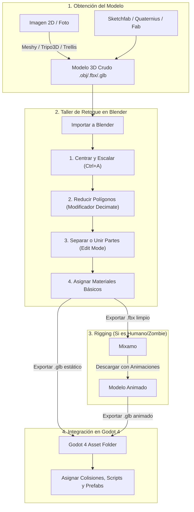

# 🧟 Guía de Herramientas, Assets 3D e IA para Videojuegos

> **Objetivo:** Guía práctica y actualizada para creadores y desarrolladores indie (enfocada en **Godot 4** y **Blender**). Esta guía recopila las mejores opciones para obtener personajes, objetos, armas, escenarios y texturas mediante **librerías pre-hechas** o **generadores de IA (Image-to-3D)**, con el flujo de trabajo para retocarlos y optimizarlos sin necesidad de modelar desde cero.

---

## 📑 Tabla de Contenidos
1. [Clasificación por Modelo de Precio](#-clasificación-por-modelo-de-precio)
   - [1. Gratuitos y Open Source (100% Gratis / CC0)](#1-gratuitos-y-open-source-100-gratis--cc0)
   - [2. Pago Único (Licencias Perpetuas)](#2-pago-único-licencias-perpetuas)
   - [3. Suscripción y Freemium con Créditos (IA en la Nube)](#3-suscripción-y-freemium-con-créditos-ia-en-la-nube)
2. [Herramientas por Categoría de Uso](#-herramientas-por-categoría-de-uso)
   - [Generadores de IA (Image-to-3D / Text-to-3D)](#ia-image-to-3d--text-to-3d)
   - [Personajes, Rigging y Animación](#personajes-rigging-y-animación)
   - [Objetos, Armas y Kits Modulares](#objetos-armas-y-kits-modulares-props)
   - [Texturas PBR, Materiales y Cielos HDRI](#texturas-pbr-materiales-y-cielos-hdri)
   - [Escenarios y Terrenos en Godot](#escenarios-y-terrenos-en-godot)
3. [Pipeline Recomendado: De la IA/Asset a Godot](#-pipeline-recomendado-de-la-iaasset-a-godot)
4. [Guía Rápida de Retoque en Blender](#-guía-rápida-de-retoque-en-blender-para-no-modeladores)

---

## 💰 Clasificación por Modelo de Precio

---

### 1. Gratuitos y Open Source (100% Gratis / CC0)

Recursos y software completamente libres de costos recurrentes y con licencias comerciales permisivas.

| Herramienta / Plataforma | Categoría | Descripción | Enlace |
| :--- | :--- | :--- | :--- |
| **Blender** | Software 3D | El estándar libre para modelado, retopología, ajuste de escala, UVs, animación y exportación a `.glb`. | [blender.org](https://www.blender.org/) |
| **Godot Engine 4** | Motor de Juego | Motor ligero, potente y libre (licencia MIT), ideal para desarrollo 3D moderno con pipeline GLTF nativo. | [godotengine.org](https://godotengine.org/) |
| **Mixamo (Adobe)** | Rigging & Animaciones | Miles de animaciones y personajes humanoides (incluyendo zombies y sobrevivientes). Auto-rigging gratuito en 1 minuto. | [mixamo.com](https://www.mixamo.com/) |
| **TRELLIS (Microsoft)** | IA Image-to-3D | Modelo open source de alta fidelidad geométrica. Se puede probar gratis en la nube (Hugging Face) o correr localmente con GPU NVIDIA. | [Hugging Face Space](https://huggingface.co/spaces/JeffreyXiang/TRELLIS) |
| **Hunyuan3D-2 (Tencent)** | IA Image-to-3D | Generador open-source líder en calidad de texturas PBR y alineación geométrica para videojuegos. | [Hugging Face Space](https://huggingface.co/spaces/Tencent-Hunyuan/Hunyuan3D-2) |
| **TripoSR (Stability AI)** | IA Image-to-3D | Generación ultrarrápida (menos de 1 segundo). Modelo open source bajo licencia MIT. | [Hugging Face Space](https://huggingface.co/spaces/stabilityai/TripoSR) |
| **Quaternius** | Assets 3D (CC0) | Cientos de modelos modulares (armas, apocalipsis, supervivientes, edificios) con animaciones y texturas libres de derechos. | [quaternius.com](https://quaternius.com/) |
| **Kenney.nl** | Assets 3D (CC0) | "El padrino de los assets indie". Miles de props, sonidos, interfaces y kits modulares limpios y optimizados. | [kenney.nl](https://kenney.nl/) |
| **Poly Pizza** | Assets 3D (CC0) | Biblioteca de miles de modelos Low-Poly gratuitos donados por la comunidad de Google Poly. | [poly.pizza](https://poly.pizza/) |
| **Sketchfab (Filtro Free/CC)** | Repositorio 3D | Modelos 3D descargables subidos por artistas. Se debe filtrar por *Downloadable* y licencia *CC-BY / CC0*. | [sketchfab.com](https://sketchfab.com/) |
| **Fab.com (Filtro Free)** | Repositorio 3D | El nuevo marketplace de Epic Games (fusión de Unreal Marketplace y Quixel). Incluye cientos de packs mensuales gratis. | [fab.com](https://www.fab.com/) |
| **MB-Lab (Blender)** | Add-on Personajes | Generador de humanos personalizables con sliders directamente dentro de Blender (open-source). | [mb-lab-community.github.io](https://mb-lab-community.github.io/) |
| **MakeHuman** | Software Personajes | Herramienta independiente para crear modelos humanoides paramétricos y exportarlos con esqueleto. | [makehumancommunity.org](http://www.makehumancommunity.org/) |
| **Poly Haven** | Texturas & HDRIs | Texturas PBR en 1K/2K/4K y cielos HDRI con iluminación realista bajo licencia CC0 (dominio público). | [polyhaven.com](https://polyhaven.com/) |
| **ambientCG** | Texturas PBR | Más de 2.000 materiales PBR (asfalto, madera rota, metal oxidado, sangre/tierra) 100% gratuitos. | [ambientcg.com](https://ambientcg.com/) |
| **Material Maker** | Texturizado | Generador procedural de materiales PBR por nodos (alternativa open-source a Substance Designer construida en Godot). | [materialmaker.org](https://www.materialmaker.org/) |
| **Krita / GIMP** | Edición 2D | Pintura digital y retoque de texturas, decals, sprites y mapas de normales. | [krita.org](https://krita.org/) |

---

### 2. Pago Único (Licencias Perpetuas)

Herramientas y add-ons que se pagan una sola vez y se pueden usar de por vida sin cuotas mensuales.

| Herramienta / Add-on | Precio Aprox. | Descripción | Enlace |
| :--- | :--- | :--- | :--- |
| **ArmorPaint** | ~$20 USD *(gratis si se compila)* | Software para pintar texturas 3D en tiempo real con capas PBR (la mejor alternativa ligera y de pago único a Substance Painter). | [armorpaint.org](https://armorpaint.org/) |
| **Substance 3D Painter (Steam)** | ~$150 USD *(licencia anual perpetua)* | El estándar AAA de texturizado 3D. Comprado en Steam incluye la versión del año en curso con licencia perpetua (sin suscripción a Adobe Creative Cloud). | [Steam Store](https://store.steampowered.com/) |
| **Human Generator v4** | ~$68 USD | Add-on para Blender que genera personajes hiperrealistas con ropa, cabello, rasgos faciales y expresiones con 1 clic. | [BlenderMarket](https://blendermarket.com/products/humgen3d) |
| **Auto-Rig Pro** | ~$40 USD | Add-on esencial para Blender. Permite hacer rig profesional a cualquier personaje y exportar animaciones compatibles con Godot, Unreal y Unity. | [BlenderMarket](https://blendermarket.com/products/auto-rig-pro) |
| **Kits de Assets Temáticos (Fab / Unity / CGTrader)** | $10 - $60 USD por pack | Packs completos de ambientación apocalíptica (ej: hospitales abandonados, armas tácticas, vehículos destruidos). | [fab.com](https://www.fab.com/) / [CGTrader](https://www.cgtrader.com/) |

---

### 3. Suscripción y Freemium con Créditos (IA en la Nube)

Servicios que ofrecen créditos gratuitos de prueba o mensuales, y planes de suscripción para generación masiva de modelos 3D con IA.

| Plataforma | Modelo Gratuito | Plan de Pago | Especialidad / Ventajas | Enlace |
| :--- | :--- | :--- | :--- | :--- |
| **Meshy.ai** | 200 créditos gratis al registrarse + créditos diarios | Pro ~$20 USD/mes | **Líder todo en uno:** Genera modelos desde imagen o texto, texturas PBR, auto-retopología (reduce polígonos) y auto-rigging. Plugin directo para Blender. | [meshy.ai](https://www.meshy.ai/) |
| **Tripo3D** | Créditos gratis iniciales y recargas limitadas | Pro ~$15.90 USD/mes | **Velocidad y topología limpia:** Excelente para generar props (armas, mochilas, comida, barricadas) en segundos con topología para juegos. | [tripo3d.ai](https://www.tripo3d.ai/) |
| **Rodin (Deemos / Hyper3D)** | Previsualización gratuita ilimitada | Pago por descarga ($0.50-$1.50) o ~$30 USD/mes | **Fotorrealismo extremo:** Produce mallas de altísima definición con texturas 4K PBR y geometría quad-dominant. | [hyperhuman.deemos.com](https://hyperhuman.deemos.com/rodin) |
| **Sloyd.ai** | Plan gratis con exportaciones limitadas | Pro ~$15 - $20 USD/mes | **Modelado paramétrico/IA:** Crea modelos Low-Poly geométricamente perfectos para videojuegos (edificios, muebles, señales) ajustables por sliders o texto. | [sloyd.ai](https://www.sloyd.ai/) |
| **3D AI Studio** | Prueba gratuita | ~$19 USD/mes | **Agregador:** Plataforma que une los motores de Meshy, Tripo y Rodin bajo una sola suscripción unificada. | [3daistudio.com](https://www.3daistudio.com/) |

---

## 🎯 Herramientas por Categoría de Uso

### IA: Image-to-3D / Text-to-3D
1. **Para props rápidos (cajas, latas, medicamentos, herramientas):** `Tripo3D` o `Meshy.ai`.
2. **Para assets héroe o principales (vehículos detallados, jefes zombies):** `Rodin (Hyper3D)` o `Hunyuan3D-2`.
3. **Para estructuras limpias y modulares:** `Sloyd.ai`.
4. **Si tienes GPU potente (RTX 3060 o superior) y no quieres pagar:** `TRELLIS` o `Hunyuan3D-2` en local/Hugging Face.

### Personajes, Rigging y Animación
1. **Zombies y Sobrevivientes con animaciones listas:** `Mixamo` (Gratuito).
2. **Creación de personajes humanos sin costo:** `MB-Lab` (Blender) o `MakeHuman`.
3. **Personajes realistas con 1 clic:** `Human Generator` (Blender Market).
4. **Animar y esqueletos profesionales:** `Auto-Rig Pro` (Blender Market) o `Rigify` (Nativo gratuito de Blender).

### Objetos, Armas y Kits Modulares (Props)
1. **Packs completos listos para descargar:** `Quaternius` (Apocalypse Pack, Survival Pack) y `Fab.com`.
2. **Modelos individuales específicos:** `Sketchfab` (con filtro descargable).
3. **Creación de variantes:** Generar concepto con Midjourney/DALL-E/Stable Diffusion -> Pasar por `Meshy` o `Tripo3D` -> Limpiar en `Blender`.

### Texturas PBR, Materiales y Cielos HDRI
1. **Superficies de suelo, paredes y metales:** `Poly Haven` y `ambientCG` (100% Gratis).
2. **Pintar sangre, desgaste o suciedad en tus modelos:** `ArmorPaint` (Pago único ~$20) o `Blender Texture Paint`.
3. **Crear materiales procedurales:** `Material Maker` (Gratuito).

### Escenarios y Terrenos en Godot
1. **Terrenos exteriores grandes (montañas, bosques, caminos):** Plugin **Terrain3D** en Godot 4.
2. **Dispersión automática de vegetación, rocas y escombros:** Plugin **ProtonScatter** en Godot 4.
3. **Edificios y calles modulares:** **GridMap** nativo en Godot 4 con piezas `.glb` exportadas desde Blender.

---

## 🔄 Pipeline Recomendado: De la IA/Asset a Godot

---

## 🛠️ Guía Rápida de Retoque en Blender (Para no modeladores)

No necesitas aprender a esculpir ni a modelar polígono por polígono. Solo necesitas dominar estas **5 tareas de taller**:

### 1. Centrar el Origen y Escalar el Modelo
* **Problema:** El modelo descargado o generado con IA aparece a 10 metros del suelo o con un tamaño desproporcionado.
* **Solución:**
  1. Selecciona el objeto en *Object Mode*.
  2. Presiona `N` para ver las dimensiones reales en metros y ajústalas con la tecla `S` (Scale).
  3. Clic derecho en el objeto -> **Set Origin -> Origin to Geometry** (o a la base del suelo).
  4. Presiona `Ctrl + A` -> Selecciona **Apply All Transforms**. *(Paso crucial para que no se deforme en Godot).*

### 2. Reducir Polígonos (Optimización con Decimate)
* **Problema:** Las IAs generan mallas pesadas con 100.000 - 500.000 triángulos para un simple objeto.
* **Solución:**
  1. Ve a la pestaña de **Modifiers** (icono de llave inglesa azul).
  2. Añade el modificador **Decimate**.
  3. En la pestaña *Collapse*, baja el valor de **Ratio** (ej. de `1.0` a `0.1` o `0.05` para reducir el 90-95% de polígonos).
  4. Verifica visualmente que no pierda la silueta y aplica el modificador.

### 3. Separar Objetos Pegados
* **Problema:** Te descargas un zombie que tiene un hacha pegada a la mano o un auto con las ruedas soldadas al chasis.
* **Solución:**
  1. Selecciona el objeto y entra en **Edit Mode** (tecla `Tab`).
  2. Coloca el cursor sobre la parte que quieres separar (ej. el hacha) y presiona la tecla `L` (selecciona toda la geometría conectada).
  3. Presiona la tecla `P` -> Elige **Selection**.
  4. Vuelve a *Object Mode* (`Tab`): ahora el arma y el zombie son dos objetos independientes.

### 4. Nombrar Colisiones para Godot Automáticamente
* **Truco Godot:** Si renombras un objeto en Blender con el sufijo `-col` (ej. `Mesa_Madera-col`), cuando lo importes en Godot 4, el motor creará automáticamente un cuerpo estático y una colisión exacta sin que tengas que programarla.

### 5. Exportar a Godot
* Ve a **File -> Export -> glTF 2.0 (.glb)**.
* Asegúrate de marcar:
  * *Include -> Selected Objects* (para exportar solo lo que tienes seleccionado).
  * *Transform -> +Y Up*.
  * *Animation* (si el modelo tiene animaciones).
* Guarda el archivo `.glb` directamente dentro de la carpeta `res://assets/` de tu proyecto en Godot.

---

> 💡 **Recomendación para tu juego de zombies:**
> 1. Para **props e ítems** (medicinas, armas, barricadas, latas): Usa **Meshy** o **Tripo3D** + **Decimate en Blender**.
> 2. Para **zombies y supervivientes**: Descarga cuerpos base en **Quaternius** o genéralos con **Meshy/Tripo**, súbelos a **Mixamo** para ponerles animaciones de caminata/ataque, y expórtalos a Godot.
> 3. Para **el mapa/escenario**: Usa **Terrain3D** (para exteriores) y kits modulares colocados con **GridMap** en Godot.
